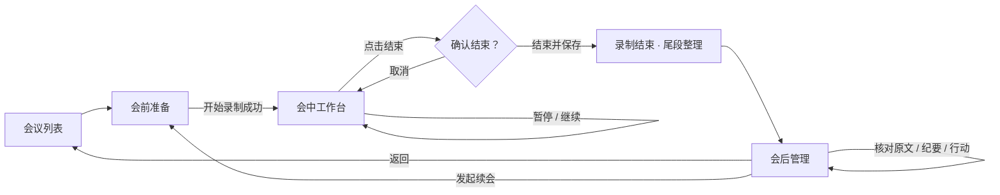

# HelmMeet 整体产品设计优化方案

版本：V1.1 · 日期：2026年10月19日 · 状态：整体产品交互与浅色UI已接入；工程回归及真实验收边界见开发验证

本方案整合工作区、知识资料与录制体验方案，并补充“结束二次确认、未开始仅显示准备内容”。V1.1按用户要求确定浅色界面、品牌蓝 #0A3281，并提供简化小帆船Logo及视觉样张。后续用户确认先落地Logo：应用内品牌、浏览器图标、macOS应用与菜单栏图标已接入；其余配色、页面布局和业务交互已按本次用户指令统一实施，见[开发验证](./整体产品改版开发验证.md)。音频进展独立见[实录验证](./音频增强组件_真实外放与双讲验证.md)，两小时稳定性按用户要求暂缓。

## 1 产品定位与设计判断

HelmMeet 是面向企业会议场景的本地会议工作台，服务于“准备会议、留住讨论、会中辅助判断、会后核对交付”。当前交付边界是个人本机使用；企业场景不意味着已经具备组织账号、多人协同、SSO、企业权限或安全认证。

优先支持三类工作：主持人识别目标/阻塞，记录者核对原文/纪要，参会人会后追溯结论/行动。用户每个阶段面对的问题不同，因此不能把所有配置、记录、问答和结果固定铺在一个页面。

核心规则：

1. 按会议阶段组织页面，按真实数据决定内容与动作是否可用。
2. 每页突出一个当前主动作：准备页开始、会中记录与理解、会后核对交付。
3. 可复用资产在全局维护，会议只选用所需版本；本场修订不自动污染全局。
4. 普通操作直接完成；用户主动结束录制必须确认。自动故障停止不等待确认。
5. 正常状态安静，异常信息准确且可处理；录音、转写、模型任务分别表达状态。
6. 原文、模型草稿、人工确认和背景资料来源清楚，用户始终能回溯与纠错。

将低频设置和次级功能逐层展开，符合复杂工具按任务减少首屏负担的做法。[复杂应用设计依据](https://www.nngroup.com/articles/complex-application-design/)。

## 2 信息架构：工作资产与系统配置分开

推荐导航为两个工作入口，加底部设置入口：

```text
HelmMeet
├─ 会议
│  ├─ 会议列表（默认首页）
│  └─ 单场会议
│     ├─ 会前准备
│     ├─ 会中工作台（含暂停）
│     └─ 会后管理（含尾段整理）
├─ 资料与词库
│  ├─ 资料集合 / 文件 / 解析结果
│  └─ 术语集合 / 人名与别名 / 待确认词
└─ 设置（侧栏底部）
   ├─ 文本模型：多配置、默认、连接状态
   ├─ 会议模板：通用、周会、评审、决策、复盘、头脑风暴
   ├─ 音频与转写：默认音源、设备、本地模型、语言
   └─ 数据与应用：本机位置、导出偏好、诊断、版本
```

资料与词库是反复维护和选用的工作资产，建议单列入口，避免藏在多层设置里。设置负责相对低频的系统行为。会议列表成为主导航，不再让长历史列表长期挤占所有会议的会中空间。

本期不增加项目看板、跨会议全局聊天、团队成员管理、自动发送或组织权限模块。以后真实使用证明有需求，再扩展分组和协作。

## 3 核心流程与页面职责



“发起续会”创建关联的新会议准备页，原会议保持结束状态，不悄悄续写历史录音。用户主动结束后没有虚假的“撤销结束”按钮；原内容保留，继续讨论从续会进入。

### 3.1 首页：会议列表

目的：找到一场会议、知道它进行到哪里、继续下一步。

- 顶部为“会议”和一个主按钮“发起会议”，不堆累计时长/AI 数量等仪表盘。
- 使用易扫描的行列表：会议名称、类型、日期/时间、时长、状态、一个相关操作。标题优先，次要列在窄窗收起。
- 状态以任务语言呈现：准备中、录制中、已暂停、整理中、已结束、需要处理。不要把“草稿纪要”当成“会议未结束”。
- 提供搜索和状态筛选；首版先保证名称搜索和状态筛选，跨会议全文检索不作为本轮改版依赖。
- 点击准备中的会议进入准备页，点击录制中的会议回到会中，点击已结束会议进入会后管理。对应行为不由上次随意选中的标签决定。
- 有活动录制时显示一条固定且紧凑的“正在录制〈会议〉 · 返回会议”；全应用只允许一个活动采集。浏览其他会议不改变采集目标。
- 空列表只说明“还没有会议”并提供发起入口；不显示空统计、纪要、问答或无意义的详情页。
- 草稿只在实际编辑后保存为准备中的会议；仅打开空白准备页又返回，不制造大量空会议。

### 3.2 会前：一页完成准备

目的：快速、清楚地开始录制，而不是先配置一套系统。

**首屏常用内容：**会议名称（有可修改的默认值）、会议类型（默认通用）、音源（麦克风/电脑声音/双源）、开始录制。名称和类型可在会中修改，不要求填写目标/名单才能开始。

**按需展开：**会议目标/议程、参会人、本场资料与词库、本场临时术语，以及自动总结偏好。资料直接“选用”，进入集合后能看到标准名和冲突；自由背景文本单独保留。

设备选择旁集中“设备设置 / 测试 3 秒”。测试只由用户点击触发；不默认额外录音。配置好的模型默认可用，模型缺失只影响 AI 能力，不阻止本地录音。

开始按钮只做一次明确的开始动作。操作后显示启动中，拿到真实采集成功状态才进入会中；启动失败仍停留准备页，给出设备/权限原因和重试入口，不跳到假工作台。首次必要系统权限继续使用 macOS 原生提示。

**此阶段不展示：**详情/概览结果标签、实时记录、对话原稿、总结卡、纪要版本、行动事项、会议问答、回听播放器和导出结果。这些内容尚未产生。准备信息是当前可编辑输入，不能与尚不存在的“会议详情”混在一起。

### 3.3 会中：记录与判断为核心

目的：尽量少操作、不漏录、看懂正在讨论什么。

推荐“双栏专注”布局：

```text
‹ 会议列表  方案评审 · 类型   ● 录制 12:30   音源 ▾  暂停  结束会议  ⋯
┌─────────────────────────┬──────────────────────────┐
│ 会议记录   实时 / 原稿     │ 会议总结 | 会议纪要 | 会议助手 │
│ 搜索 / 来源 / 复制        │ 当前标签相关的简短工具         │
│                         │                          │
│ 原文、修订、引用定位       │ 当前主题 / 脉络 / 未决问题      │
│ 独立滚动                 │ 或草稿 / 持续提问             │
│                         │ 独立滚动                   │
└─────────────────────────┴──────────────────────────┘
回听控件只在已有可播放音频时显示，默认折叠
```

- 顶部压到一行，窄窗最多两行；日期、背景、完整设备/模型名、版本、峰值与使用提示全部收进详情或菜单。
- 左侧默认约 55%，可调 35%–65%；会中全局侧栏可收起，返回会议列表始终可达。类型名称只显示一次，不再用“通用会议助手”占一个大标题。
- 1440×900 的目标是两侧正文可见高度至少 600px；这是后续需测量的验收目标，不是当前应用已达到的结果。
- 开始成功只进入一次专注态，之后模型返回、转写新增不抢焦点、不重置阅读位置。暂停仍保持此布局。
- 正常时不常驻“迁移模型 v1”“麦克风检查峰值”“戴耳机提示”等整行文案；实际音源失效、写盘失败和分析错误必须可见。
- 初始无确认文字：显示一句“录音正在保存，等待首段文字”，保持位置稳定；不填假数据。模型任务入口等有确认文字后可用，自动总结可以预先开启但不发送空请求。
- 原稿仍可切原始识别/当前修订，复制全文不受搜索过滤；人工笔记单独收纳，不伪装成发言。
- 录制控制独立响应，模型分析与导出等待不能让暂停/结束失效。

**三个标签的具体职责：**

| 标签 | 会中主要任务 | 交互约束 |
| --- | --- | --- |
| 会议总结 | 当前主题、讨论脉络、关键进展、卡点/未决 | 默认显示当前机器版，历史折叠；自动开关 + 实时/1/3分钟 + 立即总结 |
| 会议纪要 | 按会议类型生成“截至当前”的草稿；查看共享行动候选 | 手动生成；与总结独立版本，未覆盖部分明确标记 |
| 会议助手 | 围绕本场追问、review，提供类型相关快捷问题 | 保留当前会话，范围和引用可查；建议不当作共识 |

实时自动总结沿用 60 个非空白文字字符或 15 秒先到触发，完整任务结束后重新开窗；暂停冻结、积压保留，无新确认文字不请求。主界面显示自动开关，不再要求另开“本场分析设置”重复允许。

可比较的“记录优先”布局将原文放大，助手按需展开；适用于核对逐字稿较多的用户。首版推荐双栏，减少主持人在记录与提示之间来回切换。布局模式不改变会议数据或模型范围。

### 3.4 结束后：核对、交付、回溯

用户确认后首先停止采集并保留已写音频，立即进入会后页面。此时可能仍在尾段转写，顶部精确显示“录制已结束 · 转写整理中”。不要让用户误以为尚在录音，也不等待模型生成完才能离开。

会后页面采用“交付正文 + 按需证据”的主次结构：

- 主导航为“会议纪要 / 行动事项 / 会议助手”，默认进入纪要。
- 尚未生成纪要时，只给一个明确动作“生成会议纪要”，并能打开已存在的原文/录音；不显示多个空结果卡或伪造“已完成”。
- 尾段未完成时可以看已有文字、回听可用音频、生成有覆盖提示的当前草稿；完整转写可用后提示生成或更新完整纪要，不自动覆盖人工版。
- 纪要按本场类型组织章节，顶部区分模型草稿/人工修订/已确认及覆盖时间。编辑和重新生成均保留版本。
- 行动事项集中核对事项、负责人、期限和确认状态。缺信息保留待确认，不自动通知或派发给他人。
- 证据点击打开“原文与录音”侧栏，定位修订和时间点；可展开成完整原稿。会后不必始终让原文占一半屏幕。
- 主要动作随进展变化：生成草稿 → 核对/编辑 → 确认/导出。导出使用已选版本，不暗中导出另一个“最新”版本。
- 同一会议的会中/会后助手对话连续，默认范围为本场；未选其他会议与资料不进入上下文。
- 会议背景/参会人/已选资料收在“会议信息”抽屉。会后调整资料只能显式用于新分析，不改写历史任务来源。

结束录制不自动生成纪要，保留既有默认。自动总结已开时允许的末轮补算仍归总结策略；不把它冒充完整纪要。

## 4 数据驱动的展示与空状态

产品层展示“会前/会中/会后”，底层保存采集、转写、分析三组独立状态。不要以“进入了某个页面”作为有数据的证据。

| 实际状态 | 页面 | 显示什么 | 不应出现或不可执行 |
| --- | --- | --- | --- |
| 准备中，无采集 | 会前准备 | 输入、默认配置、选资料、开始 | 所有结果/对话/播放器/结果导出 |
| 启动中 | 会前准备 | 正在启动及当前配置，防重复点击 | 假录制时长、假原文、模型请求 |
| 录制中，无已确认文字 | 会中工作台 | 保存状态、等待首段文字、暂停/结束 | 伪造总结/问答；空文本付费请求 |
| 录制中，有文字 | 会中工作台 | 记录、原稿、可用分析/问答 | 把 partial 当最终证据 |
| 暂停 | 会中工作台 | 已有内容、继续/结束；自动周期冻结 | 取消结束弹窗后擅自恢复麦克风 |
| 正常结束、尾段处理中 | 会后管理 | 录制已结束，真实转写进度/可用内容 | “全部处理完毕”、未完成覆盖的完整纪要承诺 |
| 已结束但没有有效音频/原文 | 会后异常空状态 | 原因、能恢复的内容、创建续会/重试适用任务 | 空播放器、空纪要或没有依据的问答 |
| 采集中断 | 中断恢复页/工作台提示 | 已保存时长、缺失提示、恢复或结束 | 把中断当作用户确认结束或完整录制 |

能力由真实条件计算：has_audio、has_confirmed_text、has_minutes、has_actions、model_ready、capture_state。前端按能力展示，后端也校验空请求和状态，不能只依赖按钮隐藏。明确用户关闭/全局暂停分析的决定继续保留。

## 5 结束二次确认：统一交互契约

所有用户主动结束入口统一走同一个流程，包括会中工具栏、活动录制横条、列表操作、菜单栏/快捷键。不能有一个入口绕过确认。

**弹窗文案：**

> 结束这场会议？
>
> 〈会议名〉 · 已录制 12:30
>
> 将停止录制，已有录音和文字会保留。剩余转写将在后台完成。
>
> [取消]　[结束并保存]

- 点击“结束会议”只打开弹窗，确认前继续原状态；不能先停止录音再询问。
- 默认焦点放在“取消”，Escape 和关闭弹窗等同取消；取消不清数据、不暂停，也不把已暂停会议自动恢复录制。
- “结束并保存”确认后发送一次停止意图，按钮显示处理中并防重入。保存失败要显示真实结果和恢复入口，不能只用成功提示掩盖故障。
- 意图绑定目标 meeting_id 和当前采集会话/版本，不依赖弹窗返回时的当前查看会议。录制 A、查看 B 时必须明确显示结束的是 A。
- 旧弹窗在采集已变更/自动中断时失效，刷新状态，不停止另一个会话。后端重复结束同一会话应幂等。
- 不提供“不再提示”或直接结束的快捷绕过。常规暂停/继续不额外弹确认。
- 因设备/磁盘/睡眠等故障自动停止不能等待弹窗，保留中断/失败状态和恢复提示；应用退出仍遵循先保护采集和释放后台资源的规则。
- 弹窗需实际阻止背景操作，锁定 Tab 焦点，关闭后恢复合理焦点；使用可访问名称和说明。[W3C 模态对话框依据](https://www.w3.org/WAI/ARIA/apg/patterns/dialog-modal/)、[确认对话框语义](https://www.w3.org/WAI/ARIA/apg/patterns/alertdialog/)。

## 6 全局资料/词库与本场内容整合

沿用[知识资料方案](./知识资料与录制体验优化方案.md)的两层结构与技术边界。

- 全局“资料与词库”负责新增、集合、解析预览、标准名/别名确认、冲突和版本。首版 TXT/MD/CSV，后续有文本层的 PDF/DOCX；OCR 不混入首版承诺。
- 准备页“选用资料与词库”只展示当前需要的集合；新会议可继承最近使用的集合建议，仍让用户看到具体选择，不把所有企业资料默认带入。
- 会中在“会议信息”内补词，新增版本应用于后续识别；影响已确认文字时必须有修订、变更范围和撤销能力。
- 人名归一针对确认的同一实体；王鹤、王贺两个真实人员并存时不自动合并。不会因为有人员词库就声称支持声纹识别。
- 会后纠错可选仅本处、本场同名表达、加入指定全局集合；加入全局是明确操作，不能自动泛化到其他会议。
- 会议原文引用和背景资料引用分别标识。资料中的观点不能自动成为会上共识、负责人或期限。
- 历史会议保留当时绑定版本；更新/删除全局资产不造成历史引用无声变化，至少保留已使用的引用快照。

## 7 默认分析、模型配置与反馈层级

模型配置好即对新会议就绪，默认不需要再点本场“允许”。全局默认用于新会议，旧会议保持明确绑定和用户显式停用决定。

| 用户意图 | 操作入口 | 系统行为 |
| --- | --- | --- |
| 录音转写 | 准备页开始 | 本机采集与转写独立运行，无模型也能进行 |
| 自动理解进展 | 会中“自动总结” | 开关直接生效；无新文字不请求，默认关闭 |
| 主动生成纪要/提问 | 各标签主按钮 | 一次操作提交，不再叠加本场允许弹窗 |
| 更换模型 | 会中更多/简短模型选择，或全局设置 | 明确采用版本，旧任务取消/结果保留，后台栅栏仍有效 |
| 查服务/版本/范围 | 模型详情 | 按需可见，不常驻占据主工作区 |
| 全局暂停分析 | 设置 | 自动任务停止，其他入口不绕过明确停用 |

默认可用不等于自动外发全部资料或整段音频。本地词表提示不联网，远程文字请求只带本场任务所需内容；企业统一网络/模型管控作为后续能力，不伪称当前已有。

反馈分三层：影响当前主任务的错误行内持续显示；可恢复的转写/模型错误在对应模块展示并提供重试；普通成功用短暂状态提示。音源失效/写盘失败不能藏在模型面板；模型失败不能显示成录音失败。正常成功不重复弹窗。

## 8 排版、视觉与可访问性

采用低干扰、高可读、密度可控的桌面工具风格。**默认浅色，以白色和冷浅灰承载主要阅读区域，品牌蓝 #0A3281 用于主动作、选中态、链接及品牌标识。**替代旧方案中的绿色主色；绿色只保留“保存成功”等语义。首版不随系统自动切换深色主题，深色适配另行设计和验收。

- 会议列表用行与分组，不用大卡片占满屏幕；正文、会议信息和工具条层级清晰，尽量避免卡片套卡片。
- 文本正文建议 14–15px、舒适行距，状态/时间/来源为次级；不靠不断缩字来塞进更多控制。确认时长使用等宽数字。
- 主要按钮用具体动词：开始录制、暂停、继续录制、结束会议、生成纪要、核对行动事项、导出。避免笼统“确定”“智能处理”。
- 1024px 以下收起侧栏或变为切换入口，工作区上下布局；窄窗原文可收起，结束/暂停仍可达。320px 下不横向截断关键动作。
- 不将 hover 作为唯一发现方式，图标有文字或可访问名称；状态颜色同时有文字，浅色界面各表面组合保持对比。
- Tab 顺序按视觉任务顺序，标签支持键盘切换；结束弹窗焦点安全、不会 Enter 误结束；任务状态不频繁打断读屏。
- 原稿来源、纪要选定版本、滚动位置、未发送问题按会议保留；切换阶段只采用首次进入的合理默认，不因每次轮询重置页面。

### 8.1 配色层级与色值

整页以浅色为主；深蓝通过少量、高价值的交互建立品牌识别，不铺满导航栏、工具栏和大面积正文背景。主阅读区域保持白色，导航使用接近白色的浅灰，以留白、细分隔线和字号区分层级。浅蓝负责选中和定位，不能把每段AI内容都画成蓝色卡片。

| 角色 / Token后缀 | 色值 | 使用位置 |
| --- | --- | --- |
| 页面底色 / canvas | #F5F7FB | 列表、准备页、会后页面的外层画布 |
| 内容表面 / surface | #FFFFFF | 原文、总结、纪要、表单、抽屉、弹窗 |
| 导航表面 / sidebar | #F8FAFC | 全局侧栏和低频设置导航，保持浅色 |
| 次级表面 / surface-subtle | #F1F5F9 | 表头、折叠区、只读字段背景 |
| 分隔 / border | #DDE3ED | 纯装饰分隔线和内容分组，不能单独充当必要控件边界 |
| 控件边界 / control-border | #7C8A9E | 输入框、未选复选框、次按钮等必须辨认的轮廓 |
| 主要文字 / text | #172033 | 标题、逐字稿、纪要正文，避免整段文字用品牌蓝 |
| 次要文字 / text-secondary | #526078 | 标签、说明、背景信息 |
| 辅助文字 / text-muted | #5B6B82 | 时间、来源、占位说明，不能为了“轻”而失去可读性 |
| 品牌 / brand | **#0A3281** | Logo、主按钮、链接、活动标签下划线、选中导航文字 |
| 悬停 / brand-hover | #082A6D | 主按钮hover |
| 按下 / brand-pressed | #062257 | 主按钮active；不改变按钮尺寸 |
| 品牌浅底 / brand-tint | #EAF0FB | 活动导航、本场选用项、引用定位的临时高亮 |
| 品牌浅边 / brand-border | #CAD8F4 | 选中区域装饰边线；识别同时依靠深蓝标记 |
| 键盘焦点 / focus | #3B6BC4 | 2px外轮廓、2px间距，位于白色/浅灰表面 |
| 禁用 / disabled-bg、disabled-text | #EEF1F6 / #5B6B82 | 不可用按钮；同时disabled和说明原因，不整体降低透明度 |

这些色值统一沉淀为[CSS设计变量](./design/helmmeet-light.tokens.css)，名称前缀为`--hm-color-`。实施时先接共享主题变量，再逐组件替换旧绿色和散落色值，不同时维护两套主题常量。

### 8.2 组件、交互与状态用色

| 场景 | 视觉处理 | 约束 |
| --- | --- | --- |
| 当前主动作 | 深蓝底、白字 | 如发起会议、开始录制、生成纪要；同一任务区域保持一个主动作，避免所有按钮同等突出 |
| 次动作 | 白底、深色字、清楚边框 | 选用资料、暂停、取消；适合常用但非主要推进动作 |
| 导航 / 标签选中 | 浅蓝底或深蓝下划线，深蓝字 | 加粗、位置标记和aria-current/selected共同表达，不只换文字颜色 |
| 链接与原文引用 | 深蓝字，正文链接保留下划线 | hover加深或加强下划线；引用跳转可短暂浅蓝定位，不永久染整段原文 |
| 输入框 | 白底、可辨认的灰蓝边界，深色内容 | focus外轮廓；错误同时显示图标/文字/边框，不以红色占位符替代错误说明 |
| 自动总结开关 | 开启深蓝，关闭灰色 | 同时有开/关文字、真实checked语义；不把蓝色解释为已分析成功 |
| 结束入口 | 会中工具栏使用红字/红边次按钮 | 明确区分于蓝色继续动作；确认弹窗的“结束并保存”可用红底白字，取消仍获默认焦点 |
| 助手输出 | 白色正文、常规深色文字 | 与原文以标题、来源和“模型草稿”区别，不用紫色渐变、发光或整屏深蓝表现AI |

语义色只在对应状态使用，不与品牌色竞争：

| 含义 | 前景 / 浅背景 | 必须伴随的标识 |
| --- | --- | --- |
| 成功 | #157347 / #EBF7F0 | “已保存”“已完成”等明确文字，可配对勾 |
| 注意 / 待核对 | #8A5400 / #FFF6E5 | “待确认负责人”“转写缺段”等原因和适用操作 |
| 错误 / 危险 | #B42318 / #FFF0EE | 错误名称、处理动作；危险操作用具体动词 |
| 正在录制 | #B42318 / #FFF0EE | 实心圆点 + “录制中” + 时长；不是整页红色警报，也不频繁闪烁 |

悬停、按下、焦点、选中、禁用是不同状态：键盘焦点不能靠hover模拟，禁用不能只降低opacity，选中不能只靠鼠标悬停才能看见。不会将“录音正常”“模型成功”“权限已开”混成同一种绿色状态。

### 8.3 各阶段的应用

- **会议列表：**浅灰画布、白色行列表；选中行浅蓝，状态用紧凑标签。“发起会议”是蓝色主动作，侧栏不做深色大色块。
- **准备页：**白色输入面板，常用配置一屏完成；“开始录制”用品牌蓝。尚未发生的总结/问答不以灰色空卡片占位。
- **会中双栏：**两栏都保持白底，细线分隔；总结标签用深蓝下划线，原文以深色文字阅读。来源、时间和模型信息退到次级色，录制点保留红色，结束入口低于正文的视觉权重。
- **会后管理：**纪要以文档形式白底阅读；已确认/待核对通过文字与语义标签区分。人工修订和证据定位可用浅蓝背景；“导出”是否为主动作取决于当前交付阶段。
- **全局资料/设置：**复用相同浅色体系，资料选中和模型默认项使用品牌蓝；连接状态用语义色。复杂设置不引入第二套强调色。

### 8.4 对比度与设计验收

普通文字目标至少4.5:1，大字至少3:1；必要控件轮廓、选中指示等与相邻背景目标至少3:1。纯装饰细线可较淡，但不能用它承担唯一的控件识别。焦点还需可见、无遮挡并验证键盘路径。这是设计与后续实现目标，不代表整套应用已通过无障碍认证。[W3C文字对比依据](https://www.w3.org/WAI/WCAG22/Understanding/contrast-minimum.html)、[必要非文字对比依据](https://www.w3.org/WAI/WCAG22/Understanding/non-text-contrast.html)。

本轮按sRGB相对亮度公式计算，白字/品牌蓝约**11.76:1**，品牌蓝/浅蓝底约**10.28:1**，正文/白底约**16.27:1**。其余批准组合和计算结果见[配色对比记录](./design/contrast-ratios.json)；数值仅适用于表中对应的不透明前景/背景，不能据此允许任意叠加透明度或任意混搭。实施后仍需对实际页面、焦点、缩放、禁用和所有真实状态进行检查。

### 8.5 小帆船Logo：扬帆

**主体为一艘向前航行的简化小帆船，主色严格使用 #0A3281。**图形仅由大帆、小帆和船身三个实心形组成；两帆之间留白暗示桅杆，帆与船身之间留白保证小尺寸可辨。大帆略向右展开，表达“扬帆起航、让讨论有方向”；船身保持稳定，表达可靠记录和承载共识。

不叠加麦克风、聊天气泡、舵轮、声波、海浪和AI星点，不做立体渐变。用轮廓建立识别，避免小图标细节糊成一团。


| 资产 | 使用位置 |
| --- | --- |
| [主标SVG](./design/brand/helmmeet-logo.svg) / [透明PNG](./design/brand/helmmeet-logo.png) | 浅色导航、关于页、文档；SVG为图形母版，PNG为512×512透明导出 |
| [反白SVG](./design/brand/helmmeet-logo-white.svg) | 仅深色品牌载体；不因此把应用导航改成深色 |
| [单色SVG](./design/brand/helmmeet-logo-mono.svg) | 单色文档、灰阶场景；不引入额外品牌色 |
| [横版组合](./design/brand/helmmeet-wordmark.svg) | Logo + HelmMeet名称；字标为可编辑系统无衬线字体，图形不依赖字体 |
| [应用图标SVG母版](./design/brand/helmmeet-app-icon.svg) / [1024px PNG](./design/brand/helmmeet-app-icon.png) | 白色圆角底配蓝船；已生成并接入正式macOS ICNS各尺寸，菜单栏使用透明单色模板 |

使用规范：

- 图形画布为256×256；图形外接框周围至少保留24设计单位的净空，母版已有留白。实际界面中图标建议24–32px，16px只用独立船形，不带字标或副标题。
- 24px及以下继续使用实心轮廓，不加描边；正式菜单栏若使用，另按macOS模板图标规范制作和实机检查，不直接用彩色PNG缩小代替。
- 保持等比；不拉伸、不旋转、不改帆的相对位置，不加阴影、渐变或背景波纹。反白是同一几何轮廓的白色版本。
- 品牌标志可与HelmMeet文字组合；不要在每个面板、每条消息重复摆放。预览中的“让讨论有方向”为文案提案，不强制进入产品导航。

### 8.6 可审阅视觉样张与实施范围

[打开浅色视觉样张](./design/helmmeet-visual-preview.html) · [整张PNG预览](./design/helmmeet-visual-preview.png)。样张包含Logo大小/反白、基础色板、会中双栏和按钮状态，使用示例会议内容；只做视觉和焦点展示，不采集、不调用模型、不保存业务数据。它补充已有流程原型，不替代正式工作区实现或交互验收。

实施沿用D03/D04/D05，不另建独立业务项目：先接主题变量与品牌组件，再迁移导航/准备、会中和会后/设置，最后D06检查色值、状态、图标16/24/32px、键盘焦点和真实窗口。Logo已按用户指令单独接入侧栏、浏览器图标及macOS应用/菜单栏，并重新打包。随后按用户整体实施指令，正式界面已共享该主题变量并完成阶段化布局。

## 9 企业场景的信任与操作边界

企业用户需要的确定性体现在具体交互：知道正在录哪一场、数据保存在哪里、模型何时使用、结论引用什么、哪个内容需要确认、导出的是哪一版。

- 当前定位是本机工具，不把“资料全局”解释为组织共享，不暗中加入团队空间或向他人发消息。
- 默认本机保存、外发范围按需可查；密钥不在前端和日志，原始音轨和 ASR 修订保留。
- 共享/通知/派发未来若接入，必须独立明确操作；导出不等于已经发送。
- 长时间稳定性、采集缺失、音质、模型质量必须有实际验收；已有咔哒声已由用户确认修复，本机外放/双讲首轮结果见[实录验证](./音频增强组件_真实外放与双讲验证.md)。不以视觉原型替代其他设备/质量验收；两小时稳定性保持暂缓。

## 10 设计取舍与本期范围

| 取舍 | 本期选择 | 原因 |
| --- | --- | --- |
| 所有阶段同一大页面 vs 按阶段呈现 | 相同会议对象，三种任务页面 | 减少无数据入口和用户对状态的误解，保留数据连续性 |
| 知识库放设置深处 vs 工作资产入口 | 单列“资料与词库”，设置沉底 | 资料与术语有持续维护和选用任务 |
| 会中双栏 vs 助手抽屉 | 双栏默认，记录优先作为可选布局 | 主持人可同时看发言和卡点；逐字核对用户可放大原文 |
| 会后继续双栏 vs 交付正文优先 | 纪要/行动为主，原文证据按需展开 | 会后重点转为核对和交付 |
| 结束后自动出纪要 vs 用户生成 | 首版手动生成完整纪要 | 明确尾段覆盖，不覆盖人工版本，与自动总结分离 |
| 结束轻点即停 vs 二次确认 | 所有用户结束统一确认 | 本次用户明确要求，避免无法恢复的误停 |
| 复杂流程向导 vs 一页准备 | 常用输入一页，背景资料按需展开 | 熟悉用户使用默认值可两次主操作进入录制 |

原型提供“发起 → 准备 → 开始 → 会中 → 结束确认 → 尾段整理 → 纪要核对”路径及全局资料/设置导航。原型使用示例内容和本地交互，不进行真实录制、模型调用或保存。

## 11 开发拆分与依赖

新增 D01–D06 负责整合，不另造 J/W/T 系列的第二套功能。

| ID | 实施内容 | 依赖 / 复用 | 退出条件 |
| --- | --- | --- | --- |
| D01 状态与能力模型 | 区分准备/启动/会中/尾段/会后/异常；计算数据能力 | 现有采集、转写、任务状态 | 无数据不出现结果入口，前后端都拦空请求；TC-45 |
| D02 统一结束确认 | 全入口确认、目标绑定、取消、幂等、错误与焦点 | D01；保留 native stop/退出生命周期 | 所有用户入口一致，确认前不停止，A/B 不误停；TC-46 |
| D03 全局导航与准备 | 会议列表/搜索/状态、准备表单、设置重组；接浅色主题变量与帆船品牌组件 | D01；复用已有模型/模板及第8节视觉资产 | 准备页无结果/聊天；默认值两次主操作开录；TC-47及TC-49视觉 |
| D04 会中专注工作台 | 双栏、精简工具栏、设备弹层、数据/模型反馈 | D01–D03，直接整合 J04/J05、W04/T04 | ≥600px目标、任务不锁采集、默认分析直接用；TC-49及TC-41/42/43 |
| D05 会后交付与资料 | 纪要/行动/助手、原文回溯、版本/导出、资产选用 | 现有产物；整合 J02/J03、T01/T02 | 结束与尾段区分；来源/版本正确；TC-48及TC-39/40 |
| D06 集成验收 | 全旅程、错误、A/B、键盘；浅色对比/状态/小尺寸Logo；适用音质，真实两小时暂缓 | 上述阶段；复用既有音频回归 | 原型不当作实机结果；R39–R49有明确实际结果与待验项 |

优先 D01/D02/D03，先解决误结束和未开始页面；随后 D04 接 J04/J05；再推进 D05 中的资料/词库 J02/J03；最终 D06。当前D01–D05代码已接入，D06工程/隔离界面回归与待实机边界见[开发验证](./整体产品改版开发验证.md)。

## 12 新增验收与设计验证

| 需求 / 验收 | 核心标准 |
| --- | --- |
| R45 / A45 | 阶段与真实数据驱动展示，未启动仅准备；录音/转写/分析状态不混淆 |
| R46 / A46 | 所有用户结束入口二次确认，取消无副作用，安全焦点和目标会话绑定 |
| R47 / A47 | 会议列表、工作资产、设置职责分明，一页准备和任务导向返回 |
| R48 / A48 | 会后以纪要/行动交付为主，尾段覆盖、人工版本、原文回听和导出可核对 |
| R49 / A49 | 按阶段合理布局、独立任务反馈、A/B隔离、键盘与窄窗可操作；浅色为主、#0A3281品牌蓝、统一帆船Logo与对比度规范 |

初始可用性目标（待真实用户验证）：默认配置可用时从列表两次主操作进入录制；取消结束不丢一个采集窗口；准备页零结果/聊天入口；第一次使用可判断“录音是否在进行、当前资料/模型是什么、下一步做什么”。不把设计目标写成已测数据。

以下为此前设计阶段记录，最新正式实现见[开发验证](./整体产品改版开发验证.md)。设计阶段仅包括文档/编号一致性和示例原型交互/排版检查；未改正式 UI、数据库和默认分析行为，未录制真实音频、未调用模型服务。实施时需追加必要迁移并重新进行全链路验收。

### 设计阶段检查结果（历史）

2026年10月19日：文档链接检查覆盖 23 份文档，0 错误；`git diff --check` 通过。示例原型在隔离 Chrome、内容宽度 1024px 和 320px 下检查通过：准备页无结果/问答、确认前保持录制、取消保持录制或暂停、Escape 取消、浏览历史后返回活动会议、尾段与纪要分离、手动生成/人工确认/原文展开、无横向溢出；两种会中布局均可打开助手并进入结束确认。宽窄窗正文与确认弹窗截图已人工检查。

以上为合成内容和界面状态检查，不能替代 TC-45–49 的正式应用验收；未验证真实采集停止、后端幂等/陈旧任务、完整读屏/键盘矩阵、长会议和音质。没有进行正式应用构建或回归测试，本轮未修改其业务代码。

### V1.1视觉增补检查

2026年10月19日：新视觉样张在隔离静音Chrome以1328px/390px渲染，已查看宽窄窗口及小帆船PNG，图片完整加载、无页面横向溢出；修正窄窗标志版本栏挤压。SVG XML解析、PNG完整性及16组指定配色对比度核算通过。npm run verify通过（TS7、Python18、typecheck、28份文档链接、Vite构建），git diff --check通过。未新增排版业务单测，未改正式界面或应用图标，未进行真实录音/模型调用；完整产品状态、读屏、焦点和各设备图标仍需D03–D06实施时验收。


### 整体实施补记

此前“仅设计/仅Logo”的记录保留为历史阶段，不再代表当前代码状态。2026年10月19日已按用户明确指令实现阶段导航、浅色视觉、结束确认、默认分析、会后交付与两层资料/词库。最新实现、限制、复现与验收以[整体产品改版开发验证](./整体产品改版开发验证.md)为准。两小时真实稳定性继续暂缓。
