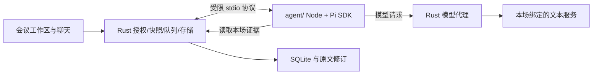

# 会议类型、模板与对话助手方案

版本：V0.1 · 日期：2026年10月18日 · 状态：类型模板与基础持续对话已接入；Pi 与工具运行时待实验

## 1 结论与现状

建议支持会议类型，并把现有“问答”升级为绑定单场会议的持续对话。会中帮助发现目标、约束和推进条件的缺口，会后帮助核对决定、追溯依据和准备跟进。不同类型共享一个对话引擎，通过结构化模板改变观察维度和输出；不需要每种类型启动一个独立 agent。

现有运行版已有通用/项目助手、目标/议程等背景、整场/最近十分钟/选中片段问答、引用与模型配置绑定。主要差距是：没有独立会议类型；模板在原记录上更新，尚无可追溯的不可变模板版本；问答保存为 answer 产物，没有真正的多轮会话；没有 Pi 运行时。本文描述新增目标，不表示这些功能已实现。

本次先确定产品与工程方案。真实录音与既有 P0 实机验收继续按原计划，不能因新增对话方案而登记通过。

## 2 类型、模板与模型的关系

| 概念 | 回答的问题 | 保存方式 |
| --- | --- | --- |
| 会议类型 meeting_type_id | 这场会议要完成什么工作 | 周会、方案评审、决策、复盘、头脑风暴、通用 |
| 模板 template_id + version | 按什么检查清单观察，如何整理 | 不可变版本；含类型、诊断维度、分阶段指令、纪要结构、快捷问题 |
| 个人偏好 | 从谁的视角、用什么表达方式 | 模板内的可配置角色/风格；会议信息可补充用户关注点 |
| 模型 profile_id + config_version | 由哪个服务和模型处理 | 复用已有逐会议绑定及授权，不与会议类型耦合 |
| 本场背景 context_revision | 目标、议程、参会人、术语是什么 | 本场版本化；明确标注为用户提供的背景 |

下一扩展版本每场选择一种主类型及一个适配模板；同类型可有多个用户模板。新建时选类型，展示模板关注点和纪要预览，再填本场目标。模板不能覆盖应用证据规则或扩大权限。自动推荐类型、按议题使用不同类型、多个聊天分支放到后续版本。

修改模板创建新版本；默认设置只影响新会议。已有会议显式采用后只影响后续请求，旧产物、旧聊天回答保留原类型/模板来源。会中切换需取消旧分析并设置写回栅栏，不重写历史。旧 general/project 模板及会议按已知数据保留原名称和可恢复快照，类型缺失标为通用/未分类；不能把所有历史 project 会议猜成周会。迁移无法恢复的旧模板正文标注“历史版本不可恢复”，不补造来源。

## 3 首批内置模板

| 类型 | 重点检查 | 纪要中的专属内容 | 会中快捷问题 |
| --- | --- | --- | --- |
| 周会 weekly | 目标、上期承诺、本期进展、偏差、阻塞、依赖、下期安排 | 目标与进展对照、阻塞及协助、下期事项 | 哪些事项卡住了？负责人和下一步是否明确？ |
| 方案评审 design_review | 问题边界、约束、备选方案、权衡、假设、风险、验证/回滚、通过条件 | 方案对比、争议、验证缺口、评审结论及条件 | 哪些假设未验证？还有哪些通过条件没澄清？ |
| 决策 decision | 决策问题、选项、标准、依据、决策人、状态、前提、异议、行动 | 决策记录、采纳理由、保留意见、未决条件 | 已经决定了什么？哪些仍只是建议？ |
| 复盘 retrospective | 预期与实际、时间线、事实、原因假设、经验、改进实验 | 事实与假设分列、经验、可验证的改进 | 哪些原因只有猜测？改进措施怎样验证？ |
| 头脑风暴 brainstorming | 问题与边界、想法、聚类、重复点、筛选标准、待探索方向 | 想法池、主题分组、候选方向、下一步探索 | 有哪些方向未探索？筛选标准是否明确？ |
| 通用 general | 目标、议题、结论、待办、未解决问题 | 通用纪要结构 | 截至现在有哪些未解决问题？ |

所有模板保留公共的事实、决定、行动候选及证据结构。周会若未导入上期承诺，只能说“未提供对照材料”；头脑风暴中的想法不能自动成为决定或已确认待办；复盘不能推定责任人或把相关性当原因。

模板是数据。建议字段为 schema_version、id、version、meeting_type_id、name、focus_dimensions、clarification_checks、phase_instructions、summary_sections、quick_questions、style。发布时本地 Schema 校验，不支持脚本、动态下载或任意工具声明。

## 4 对话体验与提示词

### 4.1 会前、会中、会后

| 阶段 | 主要用途 | 上下文与限制 |
| --- | --- | --- |
| 会前 | 完善目标、议程、必答问题和评审/决策条件 | 只有用户背景时输出准备建议，不伪造已经发生的讨论 |
| 会中 | 追问进度、未澄清目标、明确阻塞、争议和下一步 | 基于提问时已确认文字；展示依据截至时间、转写积压和缺失范围 |
| 会后 | 核对结论、比较方案、追溯依据、草拟跟进与补充问题 | 仍只基于本场及已授权背景；未补转完成时不能宣称整场完整 |

每场默认一个持久化对话，会中到会后延续；重启后可以继续追问。界面选择历史会议即可打开对应聊天，切换会议不能带入另一场聊天。首版不提供跨会议问答、长期个人记忆或自动向参会人发言。

录制会议 A 时允许查看并询问会议 B。顶部始终显示 A 正在录制，聊天明确标注 B；查看 B 不改变采集目标，录制控制显式指向 A，不能因聊天选中项变化停止或暂停错误会议。

快捷问题随类型及阶段变化。会中默认用户主动提问；自动总结的独立开关、实时/1/3 分钟和完成后窗口按[工作区优化方案](./会议工作区与自动总结优化方案.md)细化，仍待开发。主动提醒以后单独增加频率、静默和去重设置，避免模型持续打断会议或每句话触发付费分析。

### 4.2 提示词的组合

按应用固定规则 → 类型检查清单 → 会前/中/后任务指令 → 本场背景 → 本次意图与范围 → 会话历史及检索证据组合。模板和用户输入不能改变前面的权限、隔离和证据规则。阶段由应用根据会议状态确定，结束后的补转属于会后且显示覆盖不足，模型不能自行改阶段。

相同问题“目前有什么目标没有澄清”：周会检查目标/交付物/负责人/时间/依赖，方案评审检查问题边界/约束/验证和通过条件，决策会检查选项/标准/决策权限/生效条件。差别来自检查标准，不只是替换助手人设。

每次回答采用以下结构，按需要省略空项：

- **已明确的事实**：本场原文证据；用户提供的背景另标来源。
- **待澄清项**：缺少哪项信息、为何影响推进、建议现场追问什么。
- **明确阻塞**：原文明确表示无法继续的事项；相关条件、负责人未知则待确认。
- **推测风险/建议**：从已知事实推导的可能影响，不写成会议已确认的结论。
- **范围说明**：截至时间、所用范围、未覆盖区间和检索/扫描完整性。

“未检索到”不等于“整场没有”。检查“哪些目标未澄清、所有阻塞”等覆盖性问题，需要扫描请求范围内全部已确认片段或可验证的完整索引，保留覆盖清单；预算不足则列出已检查部分，不能做全局否定。即使全范围扫描完成，也只表示记录中未明确，不证明现实中不存在。partial 文本只作预览，不进入证据。

例：用户问“目前卡点是什么？”，回答“测试环境权限尚未开通，发言称集成测试因此无法开始［原文引用］；解决负责人在当前记录中未明确。建议追问谁负责、预计何时恢复。”继续问“那第二个卡点谁负责？”，应结合上一条回答确定所指，再查原文；没有依据就回答待确认，不能从职位或聊天措辞推定人选。这里的文字仅为交互示例，不是实际会议结果。

### 4.3 历史、修订与外发

聊天历史用于理解指代，不作为新的事实证据。沿用旧回答时重新核对其原始引用，改文后提示旧回答过期；用户新说的背景标为用户输入，不能伪装成会议发言。长聊天压缩保留消息 ID、原始证据指针和未决问题；不能用反复总结代替原文核对。

远程请求新增范围 chat_context，包含本场问题、相关历史回答及用户补充背景，需更新授权展示。旧的转写分析授权不能默认为已授权完整聊天历史。切换到新服务/模型版本仍按已有规则重新确认发送目标与范围，选择配置不触发自动补发。会话可清空；在途任务先失效，数据库清理覆盖消息、上下文缓存和相关派生数据。整场删除沿用 tombstone/清理队列，已外发内容无法撤回。

## 5 是否使用 agent，以及 Pi 的取舍

持续对话本身不依赖 agent：已有分析适配器增加会话历史和快照便可提供基础追问，直接运行在 Rust 中，无需启动 Node/Pi。Agent 在长会议中按问题多轮检索、补查证据、检查覆盖时更有价值。推荐先交付模板和基础对话，同时进行 Pi 的独立验证，通过后用于受限会议检索，不把正常聊天依赖于一个尚未验证的工具循环。

`@earendil-works/pi-coding-agent` 官方提供 TypeScript SDK，可嵌入 Node/Bun 并显式配置会话、模型、资源和工具，适合做候选运行时。[官方 SDK](https://pi.dev/docs/latest/sdk)。但 Pi 默认开发助手继承宿主进程权限，不能把工具开关当作系统安全沙箱。[安全说明](https://pi.dev/docs/latest/security)。

采用条件：SDK 模式、专用 sidecar、只读会议工具、应用管理会话、Rust 代理模型请求。官方 full-control 示例提供替换资源与状态管理的方式；接入时禁用默认工具和目录发现，显式提供内存会话及受控资源，不使用默认创建会话的最简示例。[官方完整控制示例](https://github.com/earendil-works/pi/blob/main/packages/coding-agent/examples/sdk/12-full-control.ts)。

截至查阅日，官方 main 分支 coding-agent 包元数据为 1.3.0、Node 要求至少 22.19.0、MIT 许可。这不代表已核验 npm 最新发布或完成本机安装；现有工程 Node 最低声明为 22.18，接入时需统一提升并验证锁定版本。coding-agent 包包含额外运行依赖，应测量包体、启动及打包成本。[官方包元数据](https://github.com/earendil-works/pi/blob/main/packages/coding-agent/package.json)。

若 coding-agent 的资源隔离、凭据代理或包体不符合条件，可评估同仓库较底层的 pi-agent-core；变更需记录实验结果。基础对话可独立交付，不能在 Pi 失败后悄悄换另一服务或重复调用模型。

## 6 架构与 agent 目录



Rust 继续拥有数据库、Keychain、网络策略、配置绑定、取消和最终写回权。Agent 只拿本次会话的能力句柄和脱敏模型元数据，真实 API Key、数据库连接、音频/模型路径不传给它。通过 stdio 回调 Rust 的模型代理，不新增公开本地 HTTP 端口。

模型代理是新增工程，不是现有摘要接口的简单透传：需支持 tool definitions、assistant tool_calls、tool_call_id、tool results、结束原因、取消、用量和增量事件的双向转换；服务端限定模型/目标/工具白名单和预算，禁止 agent 自行指定 URL 或请求头。Pi 官方支持自定义 provider/stream，这说明接入方向可行；具体消息桥接和流式行为仍需 T00 假服务实验验证。[官方 Provider 接口](https://pi.dev/docs/latest/custom-provider)。

模型连接测试需分别报告普通对话和工具调用能力，不能由模型名或“OpenAI 兼容”推定。工具调用不兼容的配置仍可使用基础对话，界面说明所用引擎；单个回合只采用一条生成路径。定时总结和纪要初期沿用现有 Rust 分析，不为同一请求额外跑一遍 agent。

计划代码位置如下；本次只建立 [agent 目录说明](../agent/README.md)，未添加运行时或依赖。

```text
agent/
  src/index.ts                 sidecar 协议入口与生命周期
  src/runtime/pi-runtime.ts    Pi SDK 适配，隐藏第三方会话 API
  src/provider/rust-broker.ts   模型请求/事件桥接
  src/tools/                   受限会议读取工具
  src/prompts/                 公共规则、阶段任务与类型模板组装
  src/protocol/                stdio 信封及运行时 Schema
  tests/                       假服务、隔离、取消和证据测试
```

AgentRuntime 对外只暴露 startTurn/cancelTurn/dispose；Pi 的状态和类型不传播到 UI/领域层。生产应用随包提供验证过的 Node 运行时和构建产物，用户无需安装 Node 或 Pi CLI；含原生/WASM 依赖的资源路径、许可与签名需实测。普通前端构建不自动启用 sidecar。

### 6.1 工具边界

首版只提供 get_meeting_context、get_confirmed_transcript、search_transcript、get_evidence、get_actions、get_coverage。工具只返回本次冻结快照内、授权范围内的数据，分页带覆盖信息。meeting_id 由 Rust 能力句柄绑定，不接受模型更换会议；无任意 SQL、文件路径和 URL 参数。所有输入与结果有大小上限，后端逐次检查 generation、授权和片段归属。

不开放 read/write/edit/bash、codemode、MCP 发现、网页搜索或外部发送工具。提议修改待办、补充背景或生成跟进草稿只显示为候选，由用户通过现有应用操作接受。会议文字中的“运行命令、读取文件、忽略规则”始终是数据，不变成可执行指令。

资源加载器只返回应用打包且经校验的资源；不发现用户或项目的 .pi、AGENTS.md、skills、扩展、提示词文件，不执行 !command 或文件引用扩展。显式管理工作目录和继承环境，禁自动模型目录刷新、缓存保温请求及其他后台网络。内存 settings/session、禁默认凭据文件，应用 DB 为唯一业务历史来源。历史重建须使用锁定 SDK 的 SessionManager 合法入口，不能只替换 agent.state.messages。

上述控制不是 OS 沙箱。T00/T05 必须验证实际文件与网络行为，并为生产 sidecar 落实宿主级文件/网络/子进程限制；未能验证限制前不启用生产 Pi 路径，保留基础对话交付。

### 6.2 调度、快照和失败

每个回合冻结 meeting_id、conversation_id、conversation_generation、turn_id、client_request_id、消息序号、会议 generation、context_revision、类型/模板版本、模型配置版本、授权版本、阶段、scope、原文修订列表/hash、覆盖截至时间。后续检索均读这个快照。ASR 追加新段不反复取消当前问题，回答显示截至时间；修改已引用文字、换模板/模型、撤销授权、清空会话和删除时取消旧任务并阻止旧结果写回。清空递增会话代次，避免清理后序号重用接受旧结果。

同一会话串行；新消息排队可撤销，重试沿用 client_request_id，用户消息与完成回答不重复提交。最终 Schema、证据和版本检查与回答入库在同一事务。流式文字先标为生成中，经过校验才成为有引用的正式回答；不展示隐藏推理链。进程崩溃后未完成回合标失败，重启不自动重放外发。

初始预算建议每回合最多 8 次工具调用、2 轮检索扩展、1 次结构修复；整体截止时间默认 60 秒、受用户配置上限约束，所有重试/修复/自动恢复计入同一预算。上下文和输出服从绑定模型预算；token/费用仅在服务有可靠用量和价格时显示，否则标估算或未知。达到限额输出可核验的部分结果或失败，不能假装已经穷尽。

用户问答优先于下一轮自动总结；已在执行的任务提供显式取消。复用/改造当前 LLM 单并发 gate 为统一调度，避免 agent 占用许可后向 Rust 代理请求又等同一许可的死锁。Agent 退出、超时或模型断网只影响本次对话，音频持久化和本地 ASR 继续。取消同时中止 Pi 和 Rust HTTP future，迟到结果仍由事务栅栏拦截。

## 7 数据与迁移

追加迁移，不能原地修改已发布脚本。建议新增 template_versions（联合主键 template_id/version，含 Schema/hash）、meeting_template_bindings、meeting_context_revisions、conversations、chat_messages、chat_turns、chat_turn_inputs、chat_evidence；外键约束跨会议引用与消息归属。模板目录只存默认/最新指针，正文版本不可更新。

chat_messages 保存用户/助手消息及状态；工具结果按可重建最小元数据和证据指针保存，禁止复制密钥和原始网络请求。chat_turns 保存完整输入身份、预算、状态及失败原因，context 压缩记录来源消息/证据。数据库是历史主数据，不另持久化 Pi JSONL。删除/清空同时覆盖派生索引和缓存。

已有 answer 产物保留原样，可作为“历史单次问答”展示；只有已存问题和来源可确定时才迁入历史记录，不能伪造缺失的用户消息或推断对话顺序。已有模板只有当前值可恢复时，应如实标记，不能声称旧产物的模板版本已还原。

## 8 开发顺序与验收

具体任务见[开发计划 T00–T05](./开发计划.md)。先落类型/模板与真实多轮会话，同时用假模型验证 Pi 的接入条件；随后接只读工具和 UI，最后完成打包、质量与故障验收。T01/T02/T04 基础链路已实现，适用自动化见[工作区开发验证](./工作区开发验证.md)；T00/T03 和完整语义/性能验收未完成，原版实机待验收状态保留。

新增需求 R23–R30、验收 A27–A32 和 TC-27–32，见[需求](./本地会议助手_需求文档.md)及[测试验收](./测试验收文档.md)。质量评估至少覆盖六种类型各 5 段匿名合成/授权会议片段，含已澄清、后来改口、明确阻塞、仅潜在风险、无依据与覆盖缺口；每类型至少 2 组连续追问。事实引用可解析和跨会议隔离要求 100%；人工标注的明确阻塞提取 Precision/Recall 暂定均不低于 90%，记录样本量和逐例错误，不能据小样本宣称普遍准确。

输出质量、工具正确性、权限边界和不影响录音分别验收。只跑 SDK 示例或成功生成一条回答，不能算会议对话功能完成。

## 9 本次方案变更验证

2026年10月18日：仅修改方案、配套工程文档并建立 agent/README.md，未修改业务代码或安装 Pi。`npm run check:docs` 检查 16 份文档，0 错误；另用一次性脚本覆盖含 agent/README.md 的 17 份 Markdown，检查本地链接、代码围栏和 R23–R30/A27–A32/TC-27–32/T00–T05 对应关系，均通过；`git diff --check` 通过。

本次未重新运行业务构建/测试、未执行新增产品用例、未采集真实音频、未调用远程文本模型。既有应用代码改动和真实设备待验收项保留原状态。上述检查仅证明文档完整性，不证明对话或 Pi 运行时可用。
