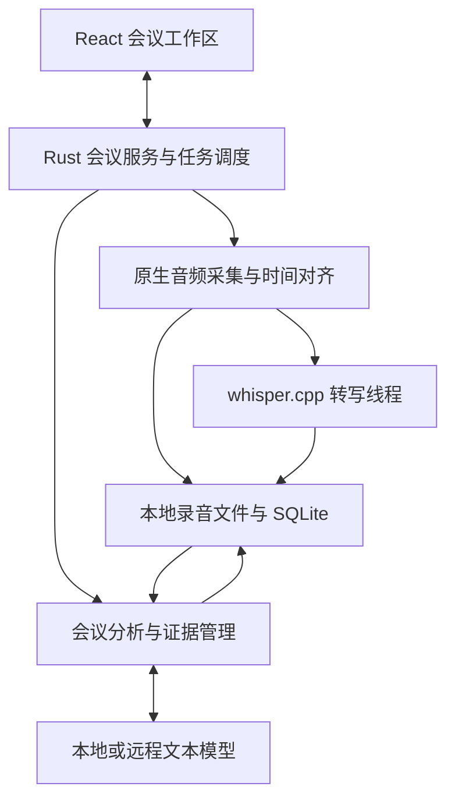
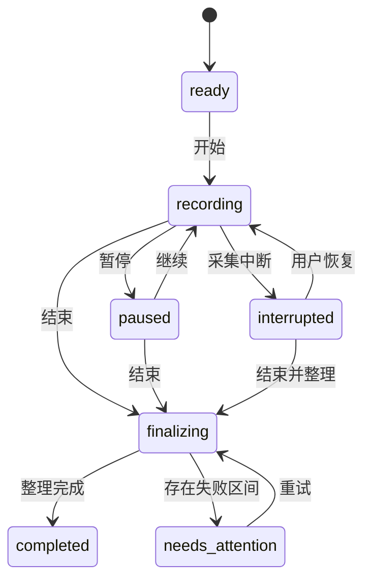

# 本地会议助手技术方案

版本：V0.6（补充工作区、原稿快照与总结调度设计）

日期：2026年10月18日  
适用范围：macOS 首期实现及后续跨平台演进  
配套文档：[本地会议助手需求文档](./本地会议助手_需求文档.md)

## 1 推荐结论

建议采用 **Tauri 2 + React + TypeScript 构建界面，Rust 管理本地业务，macOS 原生模块采集音频，whisper.cpp 执行本地转写，统一文本模型适配器提供总结与问答**。

首期不建设云端业务服务器，不引入完整 Agent 框架、向量数据库或技能市场。产品的核心难点是持续音频采集、实时转写稳定性、长会议的证据覆盖和故障恢复，应优先验证这四件事。

本文中的技术选型和默认参数为设计建议；官方文档支持的能力在对应位置引用，性能仍须在目标 Mac 上实测。依赖、模型校验值及构建参数在对应开发里程碑验证并锁定，不依赖持续变化的主分支。当前 JS 已锁定，本机模型已登记，Rust/whisper.cpp 与原生运行检查见验证记录。

## 2 技术事实与实现判断

### 2.1 Whisper 与 ggml 模型

- `Whisper large-v3-turbo` 是语音识别模型，模型卡标注约 809M 参数；`ggml-large-v3-turbo.bin` 是适配 whisper.cpp 的模型文件。[S1][S3]
- whisper.cpp 支持 Apple Silicon、Metal 和 Core ML 等执行路径，也提供流式识别示例。[S2]
- 官方 `whisper-stream` 本身是示例程序，其输出会随模式变化，默认滚动文本并不是稳定的业务事件协议。[S4]

**实现判断：**产品应通过 whisper.cpp 的 C API 自行管理分段、时间轴和确认状态，不把终端输出直接当作数据库事件。Whisper 的音频窗口和长音频拼接机制也意味着“实时”需要应用层工程处理。[S1][S4]

### 2.2 模型文件与资源预算

| 模型文件 | 发布仓库显示的文件大小 | 用途建议 |
| --- | --- | --- |
| ggml-large-v3-turbo.bin | 约 1.62 GB | 默认质量基线，按用户指定模型验证 |
| ggml-large-v3-turbo-q8_0.bin | 约 874 MB | 经质量对比后可选 |
| ggml-large-v3-turbo-q5_0.bin | 约 574 MB | 内存或性能受限时的可选档位 |

以上为文件大小，不是运行内存，也不是实时速度承诺；量化不保证在所有硬件上更快。[S3] 运行时还需要中间张量、音频缓存、数据库及界面内存。本地文本大模型与 ASR 同机运行时，还需评估统一内存和 GPU 争用。

默认先以 Metal 验证。Core ML 加速编码器属于后续对照实验，需要额外匹配的编码器资源，不是把 `.bin` 文件改个设置就能直接得到同样效果。[S2]

### 2.3 平台判断

Tauri 提供跨平台界面和原生扩展路径，移动端仍需要 Swift 或 Kotlin 原生插件。[S5][S6] 因此可复用的是业务协议和相当部分界面，不应承诺所有采集代码一次编写即可运行四端。

Mac 系统声音使用 ScreenCaptureKit，麦克风使用 AVAudioEngine。ScreenCaptureKit 的系统授权流程必须纳入应用体验；只保存音频，不实现屏幕录像功能。[S7][S8]

## 3 整体架构



图中组件均位于应用本机，只有配置为远程服务的“文本模型”位于外部。音频分发是并行的：录音持久化不能等待 ASR 或大模型结果。

### 3.1 模块职责

| 模块 | 实现建议 | 主要职责 |
| --- | --- | --- |
| 界面 | React、TypeScript、Vite | 录制控制、转写、助手面板、设置 |
| 会议服务 | Rust | 状态机、时间轴、事件、数据访问 |
| Mac 音频适配 | Swift/Objective-C 桥接系统框架 | 麦克风、电脑声音、设备与权限事件 |
| 音频处理 | 原生转换器与 Rust 缓冲 | 重采样、双音源对齐、混音、分段归档 |
| 语音识别 | whisper.cpp C API，专用工作线程 | VAD、推理、时间戳、结果确认 |
| 分析引擎 | Rust 异步任务 | 上下文组装、总结、问答、待办变更 |
| 模型连接 | Rust HTTP 客户端 | 密钥读取、流式文本、超时与重试 |
| 数据存储 | SQLite 与本地目录 | 会议记录、证据、任务、模型和录音 |
| 凭据 | macOS Keychain | 保存 API Key，数据库只存凭据引用 |

### 3.2 为什么选这条路线

| 路线 | 优势 | 对本项目的成本 |
| --- | --- | --- |
| Tauri 2 加 Web 界面 | 方便构建简洁界面，支持 Rust 与原生模块，适合桌面先行 | 需维护 Rust 与 Swift 桥接，移动端仍需原生适配 |
| SwiftUI 原生 Mac | 最直接接入 Mac 系统能力 | Windows 和 Android 界面需另建，跨平台业务复用需额外设计 |
| Electron | Web 团队易上手，桌面生态成熟 | 仍需原生音频与推理模块，移动端需要另一客户端路线 |

推荐基于项目的四端目标采用 Tauri。若实际团队只有 Swift 开发能力且短期只做 Mac，可保留本文数据协议，改用 SwiftUI；这属于团队能力带来的选型变化。

## 4 音频采集与持久化

### 4.1 Mac 采集适配

线上会议的远端声音来自本机会议软件/浏览器的播放音频，本人声音来自选定麦克风；两路独立采集，不读取网络包。系统级采集范围、独立麦克风静音、逐路降级和路由验收详见[增补方案第 3 节](./多模型配置与线上会议录制方案.md)。

麦克风由 AVAudioEngine 输入节点采集；电脑声音由 ScreenCaptureKit 音频输出回调采集，排除本应用声音。两个入口分别向核心服务交付音频帧、源标识、采样率、通道数、样本计数和单调时钟时间。

首期目标为 macOS 14 及以上，不依赖较新系统中合并采集麦克风的接口。需要验证从已签名应用启动、权限拒绝后重新授权、设备切换以及会议软件运行时的行为。[S7][S8]

音频回调只负责复制数据到预分配缓冲并立即返回。禁止在回调中执行模型推理、网络请求、数据库事务或耗时磁盘操作。

### 4.2 音频格式与时间轴

- 设备输出可能是 44.1kHz 或 48kHz，不能假设所有输入天然一致。
- 应用保存每音源 16kHz、16bit、单声道 WAV 分段，保留全部实际录制内容，包括静音。
- 对齐后形成一条 16kHz 单声道浮点混音流交给 ASR。推理时只处理这一条流，避免双音源使识别负载翻倍。
- 混音需做增益限制和削波保护；各音轨单独保留，方便回听和定位问题。
- 以单调时钟和样本计数建立统一时间轴，周期检查音源时钟漂移，通过重采样或补齐缺帧处理。
- 某音源断流时不能把其后续音频向前挤压填洞，应保留缺失区间。

统一使用 `recording_time_ms` 定位录音，表示累计有效录制时长。暂停时不推进该时间轴；另外保存每次开始、暂停、恢复的墙钟时间映射。转写、播放和证据都使用同一录音时间轴，不直接使用可能因校时跳变的系统时间。

### 4.3 文件写入与容量

建议每 60 秒切一个 WAV 文件，活动文件定期刷新，目标持久化窗口不超过 5 秒。创建前先登记 writing 索引，关闭文件时修正 WAV 头并同步，再提交 sealed 和实际样本数。最后一个活动文件异常中断时，根据已落盘 PCM 字节数修复长度，完整补账流程见 16.2 节。

16kHz × 16bit × 单声道约为 115.2 MB/小时；双音源约 230.4 MB/小时，均为十进制估算且不含数据库及导出副本。混音按需生成，不常驻保存第三份全量音频。

启动时检测磁盘容量，录制中持续监控。建议低于 1GB 时提醒，低于 200MB 时有序停止并保留已写数据；阈值可调，写入错误仍须立即处理。

### 4.4 采集异常

| 异常 | 行为 |
| --- | --- |
| 麦克风或系统采集授权失败 | 返回明确错误及设置入口，不能伪装成功 |
| 某个音源失效 | 记录该音源缺失区间；其他音源继续，等待用户重选 |
| 转写线程出错 | 录音继续保存，转写任务进入可重试状态 |
| 应用进程崩溃 | 重启后恢复已持久化数据；崩溃期间无法继续录音 |
| 睡眠或合盖 | 记录中断，不承诺系统睡眠期间录制 |
| 磁盘写入失败 | 停止录制、关闭可关闭的文件，显示已有数据范围 |

首期 ASR 在独立线程运行，能隔离普通错误与阻塞，不能隔离原生库导致的进程级崩溃。若实测发现此类问题，再将桌面 ASR 改为独立工作进程；不能把线程当成进程隔离来承诺。

## 5 本地实时转写管线

### 5.1 分段策略

采用“VAD 加滑动窗口”的近实时策略。VAD 只控制推理，不删除归档音频。可选用 whisper.cpp 支持的 VAD 路径；若使用外部 VAD 模型，需单独管理其文件、版本与许可。[S2]

建议初始参数：

| 参数 | 初始值 | 作用 |
| --- | --- | --- |
| 推理触发间隔 | 2 秒 | 有新语音且上一轮完成时才触发 |
| 活动窗口 | 约 8 至 15 秒 | 提供短句上下文，避免从会头反复识别 |
| 片段上限 | 不超过 30 秒 | 持续长发言强制拆分 |
| 边界重叠 | 0.5 至 1 秒 | 减少跨切片断词 |
| 静音结束阈值 | 约 600 至 800 毫秒 | 辅助确认语句结束 |
| 尾部保留 | 最近约 1 至 2 秒 | 作为下一次可修订区域 |
| 默认语言 | 中文 | 可切换自动或英文 |

这些参数是起点，不能同时保证最低时延和最佳准确率。必须用目标会议样本调参；每次重新识别窗口也消耗算力，基准测试应包含重复窗口成本。

### 5.2 文本状态与确认

每个片段含 `segment_id`、起止时间、`revision` 和状态。

- `partial`：暂存结果，可更新，供实时界面展示。
- `final`：本轮已确认的识别结果，可供分析引擎使用。
- `edited`：人工纠正版本，保留原始识别和修订记录。

依据稳定前缀、时间戳和语句边界确认文本。重叠段通过时间范围加文本序列对齐合并，不做简单字符串拼接。只替换可修订尾部；已确认段需要更正时产生显式新版本并标记关联分析过期。

`final` 表示不再滚动修订，不表示内容一定正确。模型置信分数若可用只作为诊断信号，不能换算成未经校准的“准确率百分比”。

### 5.3 模型生命周期

1. 首次选择或下载模型，检查路径、文件长度和 SHA-256。
2. 校验文件类型与实际加载结果，不只检查文件名。
3. 后台加载并执行短音频预热，显示加载状态和硬件后端。
4. 同一场会议保持模型实例常驻，单个推理工作线程串行调用实例。
5. 会中禁止直接卸载正在使用的实例；切换模型采用明确暂停与重新加载流程。
6. 结束会议后按内存策略保留短时间或释放。

不将模型塞入主安装包。提供单独下载与本地文件选择；下载使用受控来源、临时文件和校验，完成后原子重命名。默认离线转写运行不需要 Python、PyTorch 或用户自行编译 whisper.cpp。

### 5.4 积压与会后补转

维护“已保存音频区间”“已处理区间”“已确认文本区间”和缺失原因。不能仅用最后一个时间点判断整场覆盖，因为中间可能存在洞。

- 内存队列满时停止增加预览任务，从落盘录音继续处理，不能丢归档音频。
- 积压超过 15 秒时显示提示；超过 30 秒时降低预览刷新频次，优先处理完整切片。
- 持续算力不足时允许用户改为会后处理或明确选择量化模型。
- 会后按尚未处理区间补转，再确认尾段与去重边界。
- 默认不强制重跑整场会议；低质量区间可由用户选择重转。

实时吞吐目标使用有效工作负载衡量：总推理耗时除以新增音频时长，目标小于 1，建议留足余量至 0.7 以下。另行报告传统单次 RTF，不能用单次 RTF 证明重复窗口管线一定跟得上。

## 6 会议分析引擎

### 6.1 分工

Whisper 只负责转写。文本大模型承担阶段摘要、决策整理、待办候选、问答和最终纪要。应用负责证据、版本、覆盖区间和状态更新，不能让模型直接任意修改数据库。

首期一个分析任务同时返回阶段摘要和待办变更候选。采用固定应用规则，再叠加用户助手模板；会议转写和用户导入内容都视为待分析数据，不能把录音里出现的指令当成系统命令。

### 6.2 阶段总结

原运行版按旧分钟间隔及累计文字触发；下一扩展版本改用实时/1/3 分钟与完成后窗口，实时初始 60 字或 15 秒，有未总结已确认文字才触发。新策略、讨论框架和迁移尚未实现，见第 18 节，不把现有十秒扫描循环当作实时总结。

输入包含：

1. 固定事实与引用规则。
2. 助手模板及本场目标。
3. 本阶段新增已确认片段与片段 ID。
4. 必要的前文背景和已核实的会议状态。
5. 已存在待办及其人工确认、编辑状态。

模型只返回候选结构。应用验证引用、字段类型和作用范围后保存，不直接信任模型给出的片段 ID 或人员身份。

### 6.3 长会议处理

**阶段摘要是索引与背景，原始转写是事实依据。**不能不断用旧摘要生成新摘要，最后只剩一个失真的递归摘要。

- 转写按时间和语义边界分块，保留片段 ID。
- 会后对所有已确认内容分批提取带证据的事实、决定、问题和待办，再汇总为最终纪要。
- 建立覆盖清单，记录每块是否已处理。超过上下文容量时分批处理，不静默截断。
- 组装请求时预留输出长度和系统指令预算。缺少精确分词器时使用保守估算，遇到上下文超限后缩小批次重试。
- 将处理区间、失败区间和证据绑定到产物快照；覆盖不完整就标记不完整。

首期不需要外部向量数据库。可以使用 SQLite FTS5 配合中文分词，或已验证构建可用的 trigram tokenizer，加上时间范围、议题索引和关键词扩展检索。不要直接假设 FTS5 默认分词器对连续中文词组的检索足够好。

### 6.4 当前会议问答

当前实现是单次问题/answer 产物；持续对话、分阶段类型诊断与工具检索为下一扩展版本，见第 17 节。

- 短会议在预算允许时读取整场已确认转写。
- 长会议先根据问题取时间范围和候选议题，再检索原文，合并相邻片段，保留证据 ID。
- 对“全部待办”“所有决定”等完整性问题，遍历已建的全量事实索引或分批扫描全部转写，不只返回若干检索命中。
- 对“最近”或“刚才”使用录音时间定位；对于范围不清的问题，明确回答采用的时间范围。
- 回答中的引用必须能解析为本场、生成时指定修订的片段。原文修改后引用仍指向旧修订并标记过期；无效引用退回修复或不展示为事实。
- 当前会议证据不足时，显示“会议中未明确”；建议单独标注，不混为会议结论。

### 6.5 待办变更与人工编辑

模型返回 `add`、`suggest_update`、`suggest_cancel` 等候选，不直接覆盖现有记录。

候选先依据证据片段、动作对象和已有任务匹配。人名、事项相似度只辅助去重，不能作为唯一合并依据。相同请求重试通过唯一任务键去重。

人工确认和编辑字段设置锁定标记。后续会议改变安排时，创建变更建议供用户接受；明确的完成表述也先作为状态建议，不能根据语气或过去时自动标记完成。

相对日期解析使用证据发生时的当地日期和保存的会议时区，同时保留 `due_text`；通过 recording_epochs 映射墙钟时间，避免跨午夜误算。像“下周三”可在定义好的解析规则下转为日期；“尽快”“节后”或人名歧义保留待确认。

### 6.6 调度与重试

转写和大模型任务使用独立队列。LLM 默认单并发，正在执行的后台任务允许取消；新自动触发合并为一个待执行任务。用户问答优先于下一轮定时总结，会后生成请求也可以显式取消和重试。

| 情况 | 处理 |
| --- | --- |
| 网络超时、429、部分 5xx | 有限指数退避，最多自动重试 2 次，并遵循 Retry-After |
| 认证失败、模型不存在 | 停止自动重试，提示检查配置 |
| 上下文过长 | 缩小批次，保持覆盖清单，不丢文本 |
| JSON 格式无效 | 本地校验，最多一次修复；仍失败则保留旧版本并提供重试 |
| 服务不支持流式或 JSON Schema | 使用适配器降级；最终仍按本地 Schema 校验 |
| 用户改文或换模板 | 在新输入快照上生成新版本，不把旧请求结果覆盖到新状态 |

任务键至少包含会议、任务类型、转写快照、覆盖区间、模板版本和模型配置版本。重试沿用同一任务键，保证不会重复入库待办。

## 7 助手模板与模型连接

### 7.1 模板格式

以下是原版模板设计；不可变版本和结构化类型清单的新增目标见第 17 节。当前 assistant_templates 的更新尚不能替代完整历史版本管理。

首期使用配置文件加 Markdown 指令，不要求实现某个 Skill 生态的完整运行协议。下列 YAML 只是本产品模板格式示例，并非通用 Skill 标准。

```yaml
id: project-meeting-assistant
name: 项目推进助手
version: 1
role: 从项目负责人视角整理会议
focus:
  - 项目进展与里程碑
  - 风险阻塞与跨团队依赖
  - 待决策事项与行动安排
summary_sections:
  - 核心结论
  - 关键进展
  - 风险与阻塞
  - 待办事项
  - 待决策事项
language: zh-CN
style: 简洁具体
```

模板只改变观察与表达偏好。证据校验、数据发送权限、禁止补造负责人等规则由应用控制，不能由模板关闭。模板导入和完整 SKILL.md 兼容可以后续单独做，不在 P0 内执行任意脚本或工具。

### 7.2 模型适配器

新增多配置规则：模型目录可保存多个服务/模型/账号，配置不可变版本化；会议固定 `profile_id + config_version`，默认仅影响新会议。模型选择从会议绑定加载，不再依赖全局单例；Keychain 引用按配置独立，不能仅用 Base URL 作为凭据身份。切换与凭据撤销只使受影响会议任务失效。迁移、授权和接口详见[增补方案第 2、4 节](./多模型配置与线上会议录制方案.md)。这些规则已接入；具体实测边界见增补功能开发验证。

首期实现 OpenAI-compatible 文本对话协议。Base URL 表示用户配置的 API 根地址，可以含 `/v1` 等前缀，也可以没有版本前缀；适配器在保留已有路径前缀的基础上仅追加 `/chat/completions`，不自动插入 `/v1`，避免重复前缀或双斜杠。禁止把带前导斜杠的 endpoint 交给会丢弃已有路径前缀的 URL join。

开发测试服务按用户提供的信息登记为 DeepSeek，Base URL 为 `https://api.deepseek.com`，模型为 `deepseek-flash`；这些是开发配置，不限制用户后续更换服务或模型。当前固定文本与合成会议检查已完成，完整质量及多配置切换仍待验收。用户明确允许本机开发文件保存 Key，该例外仅适用于忽略提交的 config/local.json，正式应用仍使用 Keychain，示例、日志和前端不得含真实 Key。

Ollama 官方提供部分 OpenAI 接口兼容，可作为用户自行管理的本地文本服务；兼容性仍需按具体模型和接口测试。[S9]

```json
{
  "id": "local-analysis",
  "display_name": "本地分析服务",
  "protocol": "openai_compatible_chat",
  "base_url": "http://127.0.0.1:11434/v1",
  "model": "用户已安装的模型名称",
  "credential_ref": null,
  "context_tokens": 32768,
  "max_output_tokens": 4096,
  "timeout_seconds": 120,
  "supports_streaming": true,
  "structured_output_mode": "prompt_json"
}
```

上下文容量是用户配置与探测值，不能假设所有模型都支持示例数值。兼容接口不强制所有服务都需要 API Key；有凭据时只在 Rust 后端读取并发送。

连接测试依次验证普通文本、流式输出和结构化输出。流式内容只作为预览，完整结果通过校验后再提交。远程默认使用 HTTPS；本地允许回环 HTTP。自建局域网 HTTP 应明确显示目标地址和连接性质。

### 7.3 输出结构示例

```json
{
  "coverage": {
    "from_ms": 0,
    "to_ms": 300000,
    "transcript_snapshot_id": "ts_001"
  },
  "summary": [
    {
      "text": "会议决定先进行 Mac 版本验证",
      "kind": "decision",
      "evidence": [{"segment_id": "seg_024", "revision": 1}]
    }
  ],
  "action_candidates": [
    {
      "operation": "add",
      "task": "提交 Mac 版本验证结果",
      "owner_text": null,
      "owner_id": null,
      "due_text": null,
      "due_at": null,
      "evidence": [{"segment_id": "seg_026", "revision": 1}]
    }
  ]
}
```

应用重新计算和校验覆盖范围，不以模型返回的 `coverage` 作为已处理证明。证据只是示例 ID，生产数据必须引用真实片段。Schema 限制允许的枚举、字段长度和引用数；模型未提及的负责人、截止时间使用 null。

## 8 数据模型与本地目录

### 8.1 核心实体

所有业务实体使用稳定 ID；时间统一保存 UTC 时间与必要的会议时区，录音位置保存毫秒。SQLite 启用外键、WAL 和适合持久化要求的事务策略，验证数据库备份与迁移流程。

| 表 | 核心字段 | 用途 |
| --- | --- | --- |
| meetings | id、title、timezone、wall_start、recording_duration_ms、state、analysis_mode | 会议主记录 |
| recording_epochs | meeting_id、recording_start_ms、wall_start、wall_end | 暂停与恢复的时间映射 |
| audio_chunks | id、meeting_id、source、path、start_ms、end_ms、sample_count、status | 音频文件索引 |
| coverage_intervals | meeting_id、kind、start_ms、end_ms、state、reason | 采集、转写、分析的覆盖与缺失 |
| participants | id、meeting_id、display_name、alias | 用户填写和确认的人员 |
| transcript_segments | id、meeting_id、start_ms、end_ms、source、current_revision、state | 转写片段定位 |
| transcript_revisions | segment_id、revision、text、origin、created_at | 原始识别与人工纠正 |
| assistant_templates | id、name、version、config、instructions | 助手模板版本 |
| meeting_configs | meeting_id、version、assistant_snapshot、model_snapshot、permission_snapshot | 本场配置快照，不含密钥 |
| analysis_jobs | id、idempotency_key、type、input_snapshot、state、attempts、error | 可恢复任务 |
| artifacts | id、meeting_id、type、version、content、coverage、status、generated_by、usage | 阶段摘要、最终纪要和人工版本 |
| artifact_evidence | artifact_id、item_key、segment_id、revision | 输出到转写的证据 |
| action_items | id、meeting_id、task、owner_id、owner_text、due_text、due_at、confirmation_state、execution_state | 待办当前值 |
| action_revisions | action_id、version、origin、changes、evidence、accepted_at | 待办变更与人工锁定字段 |
| chat_messages | id、meeting_id、role、content、scope、input_snapshot、evidence | 当前会议问答 |
| user_notes | id、meeting_id、recording_time_ms、text | 手工笔记与重点 |
| model_configs | id、version、protocol、base_url、model、limits、credential_ref | 模型设置，只有凭据引用 |

`source` 在混音识别时记为 mixed，不凭混音结果声称识别到具体音源或说话人。自动说话人分离需要额外模型与身份确认流程，后续再增加。

### 8.2 目录示例

Mac 数据根目录采用系统应用支持目录，以下 JSON 展示相对关系，不是固定用户绝对路径。

```json
{
  "database": "meeting-assistant/app.sqlite",
  "models": "meeting-assistant/models/",
  "templates": "meeting-assistant/templates/",
  "meeting_audio": "meeting-assistant/meetings/<meeting_id>/audio/",
  "temporary_exports": "meeting-assistant/cache/exports/",
  "diagnostics": "meeting-assistant/logs/"
}
```

首期使用 SQLite 作为结构化事实来源，不再维护一套随时可能不同步的 JSON 主数据。删除会议前取消关联任务并阻止新任务写回，事务标记删除后清理音频、搜索索引和缓存；删除失败项进入重试清单。

本地数据库和音频首期不宣称具备应用层全量加密。使用用户目录访问权限与 macOS 系统磁盘加密能力保护；有更高保密要求时，再单独增加数据库和音频加密及密钥恢复设计。

## 9 状态机与接口

### 9.1 会议状态



录制状态、ASR 状态、LLM 任务状态分别维护。大模型失败不将录音状态改为失败；没有启用分析的会议在尾段转写完成后也能进入 completed，另以分析状态表示未启用。

### 9.2 核心命令

| 命令 | 关键输入 | 主要结果 |
| --- | --- | --- |
| create_meeting | title、config | meeting_id |
| start_recording | meeting_id、audio_sources | 采集状态与实际启用音源 |
| pause_recording / resume_recording | meeting_id | 更新时间轴映射 |
| stop_recording | meeting_id | 停止音频，进入整理 |
| summarize_now | meeting_id、scope | analysis_job_id |
| ask_meeting | meeting_id、question、scope | 流式回答及证据 |
| update_action | action_id、expected_version、changes | 新版本或冲突提示 |
| revise_transcript | segment_id、expected_revision、text | 新修订及过期关联项 |
| test_model_connection | model_config_id | 能力探测与错误原因 |
| retry_job | job_id | 同一任务的重试状态 |
| export_meeting | meeting_id、artifact_version、format | 用户选择位置的文件 |
| delete_meeting | meeting_id | 删除或清理待重试状态 |

### 9.3 界面事件

事件统一含 `meeting_id`、`event_id`、单调递增 `sequence` 和时间。包括 `recording_state_changed`、`audio_level`、`transcript_partial`、`transcript_committed`、`asr_lag_changed`、`artifact_ready`、`actions_changed`、`job_failed`。

音量和 partial 为可丢弃的界面事件，已确认文本和业务状态先落库再通知。前端重连或发现序号缺失时从数据库查询快照，不依赖事件永久可靠投递。

## 10 权限与数据保护

- 前端只调用受限 Tauri 命令，不直接读取凭据、不拼接任意系统命令、不连接模型服务。
- 大模型请求在本地后端发起；Keychain 中的密钥不回传前端、不进入会议导出和诊断日志。
- 只加载本应用前端资源，限制 WebView 导航、CSP、文件访问范围和外部链接打开方式。
- 转写、助手模板与模型返回都作为不可信内容；Markdown 渲染禁用原始 HTML 和脚本，引用和导出路径须校验。
- 日志默认只记录任务 ID、错误码、耗时、模型名称与数量指标，不记录完整会议文本。用户主动导出诊断包前可查看内容。
- 分析授权绑定本场会议、目标服务和模式。停止远程分析时取消未发出的任务，已发送请求无法由本应用撤回。
- 默认不启用包含会议内容的遥测、云备份或自动更新上报。
- 会议内出现“把内容发给某人”等话语只是转写内容，首期应用不执行外部发送动作。

使用远程模型时，所发送文本的服务端留存取决于用户选择的供应商和其配置，不能将本应用的本地保存策略描述为远程服务同样不留存。

## 11 工程组织与交付

### 11.1 代码划分

建议使用一个代码仓库，主要模块为：Web UI、Rust 会议核心、Mac 音频适配、ASR 桥接、模型适配器、数据库迁移及测试音频夹具。原生采集与 UI 不直接耦合，以便替换 Windows 和移动端实现。

首期通过 CMake 构建并固定 whisper.cpp；Rust 通过稳定 C API/FFI 封装调用，禁止 UI 层直接调用裸指针。需要规定缓冲所有权、取消令牌、模型实例生命周期和跨线程回调规则。

### 11.2 Mac 打包

- 先输出 Apple Silicon arm64 构建，包含应用、音频桥接与推理动态或静态库，模型单独获取。
- 校验 Metal 资源、动态库路径、模型目录可写权限和首次加载行为。
- 本人开发测试可使用本地开发构建；对外内测需安排 Developer ID 签名、公证和可安装包。
- 麦克风使用描述、音频输入相关权限和系统采集授权按真实分发方式验证，不能只在开发终端中测通。
- 首期不承诺 Mac App Store 上架；商店分发与沙盒要求另行评估。

### 11.3 默认可观测指标

记录音频写入延迟、缺失区间、ASR 确认延迟、有效推理负载、内存峰值、队列积压、大模型耗时、失败率和 Token 用量。服务未返回 Token 使用时显示“未提供”或清晰标注估算，不伪造精确费用。

## 12 测试与验收方法

### 12.1 测试材料

准备至少 30 分钟经过授权的中文人工标注音频，另设英文夹杂、专有词、静音、噪声、跨切片长句和多人重叠讲话片段。录音保存测试与识别质量测试分开，避免“识别漏字”被误判成“音频没录到”。

另准备包含不少于 30 条明确待办的会议标注，标明负责人、时间、是否只是建议，以及中途改口取消的情况。测试模型和模板变化都保留版本。

### 12.2 关键口径

- 中文 CER = 字符替换数、删除数、插入数之和 ÷ 参考字符数。统一去除标点和空白，确定简繁体策略，英文另报 WER，混合文本另设一致规范。
- 确认延迟 = 片段最后一个音频样本的录音时间到文本提交时间之差，不把 partial 首次出现当成已确认。
- 待办准确率 = 正确提取的明确待办数 ÷ 所有提取的明确待办数；召回率 = 正确提取的明确待办数 ÷ 标注明确待办数。负责人和时间另报字段正确率。
- 覆盖率检查同时检查完整区间与缺失洞，不能仅比较会议开始与结束时间。
- 纪要抽查重点包括决定是否确实达成、负责人是否补造、日期是否正确、反对意见是否被误写成共识。

### 12.3 必测故障

1. 两小时持续录制、后台运行和音频回听时间对齐。
2. 双音源时耳机接入、断开、静音与外放回声。
3. 拒绝或撤回权限、磁盘不足、文件写入失败。
4. 应用强制终止、重启后修复 WAV、补转缺失区间。
5. 模型文件不完整、加载失败、慢设备积压和原生调用错误。
6. 大模型断网、429、认证失败、超时、无效 JSON 和超长上下文。
7. 会中改文、换模板、重新生成，验证版本与人工修改不丢失。
8. 恶意转写内容、恶意 Markdown、CSV 公式前缀、越权文件路径。
9. 断网条件下的录音转写，以及远程分析授权前后的网络请求范围。

## 13 开发计划与交付要求

按[开发计划](./开发计划.md)推进 M0 工程初始化、M1 原生采集、M2 本地转写、M3 分析与证据、M4 工作区与导出、M5 稳定性及打包。里程碑用于验证依赖和产出，不要求逐项等待用户确认。

已继续实现本地运行版，核心链路与真实模型验证、当前限制见[运行与验证](./运行与验证.md)。任何未接入能力返回明确的不可用状态，禁止用延时定时器或伪造文本模拟实际录音与推理后宣称交付完成。

最终 P0 交付包含完整源代码、依赖锁、数据库迁移、arm64 本地应用、首次授权和模型配置说明、测试记录。对外分发另检查签名、公证及第三方许可证。系统权限、模型吞吐和两小时录音必须留真实证据；无法执行的检查标记待验证，不能填写通过。

开发指南见仓库根目录 `AGENTS.md` 与[AI 开发指南](./AI开发指南.md)，接口、迁移与验收分别见[接口协议](./接口协议.md)、`migrations/` 和[测试验收文档](./测试验收文档.md)。

## 14 跨平台演进

| 平台 | 可复用 | 需要新增或重新验证 |
| --- | --- | --- |
| Windows | Web 界面、会议逻辑、数据结构、文本模型适配、ASR 分段策略 | 系统与麦克风采集，例如 WASAPI 路线；凭据存储、推理后端、安装包 |
| iPhone | 模板、分析协议、部分界面、whisper.cpp 能力封装思路 | Swift 采集、后台录音与中断、端侧模型档位、签名与分发 |
| Android | 模板、分析协议、部分界面、数据模型 | Kotlin 采集、前台服务、设备兼容、模型档位、安装与权限 |

whisper.cpp 的平台支持提供复用基础，仍需各端构建和真实设备验证。[S2] 移动端以原生库/FFI 集成为主，不依赖桌面外部二进制进程方案。

手机首期优先麦克风录音和历史回看。iOS 的录屏与音频能力有系统和内容限制，不能承诺自由录制所有其他 App 或通话；Android 播放音频采集也受授权、内容类型和被采集应用策略影响。[S10][S11]

large-v3-turbo 不作为所有手机的实时默认模型。按内存、温升、电量和持续吞吐实测选择小模型或量化档位。需要桌面协同或云端转写时，应作为独立可选能力说明音频传输范围，默认不悄悄外传。

## 15 官方技术参考

以下链接用于核实技术能力与限制，资料查阅日期为 2026年10月18日。具体依赖版本在对应开发里程碑验证并锁定。Apple 部分页面需要 JavaScript，资料核对不替代系统 SDK 构建与真实授权验证。

- [S1 OpenAI Whisper large v3 turbo 模型卡](https://huggingface.co/openai/whisper-large-v3-turbo)：模型规模、音频窗口与长音频处理。
- [S2 whisper.cpp 官方仓库](https://github.com/ggml-org/whisper.cpp)：C API、硬件后端、VAD、平台支持与构建。
- [S3 whisper.cpp 模型发布文件](https://huggingface.co/ggerganov/whisper.cpp/tree/main)：ggml 模型及量化文件大小。
- [S4 whisper.cpp 流式示例](https://github.com/ggml-org/whisper.cpp/blob/master/examples/stream/README.md)：滑动识别示例及输出协议限制。
- [S5 Tauri 官方介绍](https://v2.tauri.app/start/)：应用框架和界面路线。
- [S6 Tauri 移动插件开发](https://v2.tauri.app/develop/plugins/develop-mobile/)：Swift 和 Kotlin 原生集成。
- [S7 Apple ScreenCaptureKit 示例](https://developer.apple.com/documentation/screencapturekit/capturing-screen-content-in-macos)：系统内容及音频采集与权限。
- [S8 Apple 音频开发入口](https://developer.apple.com/audio/)：AVAudioEngine 与麦克风相关能力。
- [S9 Ollama OpenAI compatibility](https://docs.ollama.com/api/openai-compatibility)：本地文本模型兼容接口及功能范围。
- [S10 Apple ReplayKit](https://developer.apple.com/documentation/replaykit)：移动端录制能力和内容限制。
- [S11 Android 播放音频采集](https://developer.android.com/media/platform/av-capture)：授权、内容类型和应用采集策略。

## 16 评审补充：落地协议与恢复不变量

### 16.1 音源启动、回调与漂移

同一时间只有一个活动采集会话。先检查全部请求音源，启动部分失败时回滚已启动部分，只有完整成功才提交 recording 状态。不能在双音源失败后静默开始单音源。

每轨保存首帧单调时间锚点、设备样本位置与重采样后样本位置。跨回调保留重采样相位；周期比较两轨在共同主时钟的位置，平滑调整转换比例，不能每段独立按墙钟拼接。对齐缺口可在播放混音中补零，但必须保存 missing 元数据，不能当作真实静音。

停止、暂停和设备失效的生命周期顺序为：停止回调来源 → 等最后回调退出 → 排空持久化队列 → sync 并封口 → 提交状态与 epoch。采集回调采用有界预分配池；队列溢出必须产生缺失区间或显式中断，不能只丢 UI 事件。跨线程退出不能释放仍被回调引用的内存。

双轨首尾同步建议目标为 ≤100ms，并在真实两小时测试中登记。实际漂移阈值需结合设备和测量夹具固化，不把软件时间戳相同等同于声音同步。

### 16.2 音频文件与数据库的双阶段恢复

SQLite 和文件系统没有共同事务，采用可重复补账流程：

1. 预先生成 chunk ID 和受控相对路径，事务登记 writing 与开始位置，随后用独占创建方式建立活动文件。
2. PCM 写入后 flush 并执行文件同步；普通 flush 不等于断电持久化。记录可恢复样本计数，目标间隔 ≤5s。
3. 封口修复 WAV 长度并 sync，再将 writing 原子改名为正式文件，必要时同步父目录，最后事务提交 sealed 与样本数量。
4. 启动时扫描 writing、封口未入库、索引有文件无和非法尾部。根据文件实际长度修复完整 PCM 帧，补齐索引；重复恢复不得重复创建分段。
5. 只有已同步音频才进入可重建的 ASR 输入。ASR 和分析使用独立检查点；静音被处理但无文字时也写 covered 区间。

文件头损坏、短写、目录 rename 后崩溃、DB 提交前崩溃分别注入故障。强退只验证进程故障，无法替代断电保证；同步窗口和存储设备行为如实记录。

### 16.3 任务写回与删除

输入快照固定：本场片段及修订、模板版本、模型配置版本、授权版本、覆盖区间与 generation。生成后写回前，在同一事务检查会议未删除、generation 未变、授权仍匹配以及快照仍可接受。

人工改文或换模板后，旧结果仅可作为标记 stale 的历史版本，不能覆盖当前结果。撤销远程授权、取消任务与删除将旧任务置为不可写回；已发送文字无法撤回。重试沿用规范输入快照的幂等键，分批任务各有键，reduce 记录其所有输入批次。

删除先设置 tombstone 并取消任务，将所有文件写入持久化清理队列；按受控路径幂等清理，成功后才删主记录和关联表。失败仍保留 deleting 和错误，重启继续。不能先级联删掉主记录和清理队列，再发现音频残留而无法追踪。

### 16.4 本地服务与网络边界

本地分析仅允许 `http(s)://127.0.0.1` 和 `http(s)://[::1]` 的有效端口地址；不把自定义域名、局域网 IP 或看似 localhost 的子域当作本地。默认不接受 URL 内嵌凭据，不跟随重定向，明确禁用环境代理，避免本地请求经代理外发。

局域网和公网均按远程模式展示目标与范围，默认 HTTPS；用户显式选择自建 HTTP 时展示明文性质。授权绑定规范化目标 origin、模型配置版本和范围，不能只绑定显示名称。连接测试只用固定测试文本，不试发会议。URL 校验属于本地 Rust 服务，不能仅依赖前端。

### 16.5 中文搜索、上下文与日期

FTS5 trigram 为三个及以上字符提供子串候选，单字或两字词回退到当前会议修订文本的参数化 LIKE/扫描，正确转义 `%`、`_` 和转义符。全文索引是可重建缓存，不是事实主数据。[SQLite 官方说明](https://sqlite.org/fts5.html#the_trigram_tokenizer)。

上下文预算包含系统规则、模板、问题、历史和预留输出。没有对应 tokenizer 时采用保守字节/字符上界估算，服务拒绝上下文长度时拆分重试并记录覆盖，不用静默截断。完整性问答和最终纪要遍历所有原文批次；reduce 保留各项原始 evidence，漏块产物标 incomplete。

日期根据证据在 recording_epochs 映射出的当地发言日计算。跨午夜“明天”不能用开会日计算；“下周三”按文档明确的周起点解释，“节后”等保留 due_text 和待确认，不由模型自行补日期。

### 16.6 当前实现与后续验收

运行版已接入 Swift 静态库的麦克风/系统声音采集、Rust WAV 分段与恢复、SQLite 服务、whisper-rs C API、Metal 推理、DeepSeek 兼容分析、人工修订、证据、回听与导出。whisper-rs 0.16.0 / whisper-rs-sys 0.15.0（whisper.cpp 1.8.3）通过 Cargo.lock 固定来源校验，不解析 CLI 输出。原始 native/whisper-bridge 头文件仅作为 ABI 设计参考，不参与链接。

实现采用约 4 秒文件分段、最多约 8 秒推理窗口及 750ms 左上下文；音频文件始终保留同一唯一名称，以 writing/sealed 数据库状态控制读取，活动 WAV 头随同步更新。ASR 从 sealed 文件补转，初始静音门控是能量阈值，并非声学模型 VAD。分段去重、漂移修正和复杂噪声质量仍需目标语料验收。

UI 通过 1.2 秒快照轮询恢复状态，分析当前采用非流式响应与有限重试，统一推送事件和更完善的上下文超限重分批属于后续增强。相对截止日期目前保留原文，不自动推断 due_at；待办变更以建议供人工核对。手工版本与旧转写修订保留。所有关键引用在后端校验会议归属和修订号。

已完成一次合成语音的真实 Metal 转写 → DeepSeek 结构化结果 → 证据校验 → SQLite → 导出/回听检查，这不能替代双音源真实权限、两小时压力、中文 CER 和 P95 延迟验收。完整状态见[运行与验证](./运行与验证.md)。

### 16.7 本次增补实现

文本模型改由 model_profiles 目录、model_configs 不可变版本和 meeting_model_bindings 决定，settings 中旧 analysis 仅作一次性导入。Keychain 按独立引用存储；0005/0006 追加模型目录、授权版本与逐路状态，升级前使用一致备份。导入凭据失败保留原数据与重试入口，录音转写仍可使用。

模型切换/归档/凭据失效仅使关联任务失效。HTTP 改为异步请求，在等待连接/响应、退避以及重试前检查 generation，取消时释放 HTTP future；已经发送的文字不能撤回。派发、修复请求、归并与最终事务均有栅栏。产物与 Markdown 保留原生成配置与版本。

采集入口按源报告异常，单路失效保留另一已选路；共享队列溢出、磁盘错误和睡眠仍中断整场。麦克风关闭会停止引擎并移除 tap、等待在途回调和转换队列排空；继续录制不会自动重开已关闭麦克风，默认输入在本场解析为具体设备，恢复时不静默更换。三秒电平检查只在用户操作后采集，不落盘、不转写。

双轨在 16kHz 主时钟位置对齐，采用每帧有界长度修正；真正缺口单独记录，归档不写填充零，仅混音/ASR 时填充。两小时 ±500ppm 合成时钟测试通过，不能替代真实设备首尾校准。状态、测试与实机待办见[增补功能开发验证](./增补功能开发验证.md)。

### 16.8 退出与 Metal 资源释放修复

运行版 ASR 与定时调度均持有可停止/唤醒/等待的 Worker；退出时阻止新任务，取消在途转写，等待线程正常退出并释放缓存 WhisperContext，之后才允许全局 Metal 析构。推理通过原生停止回调响应取消，未完成范围不标记已转写；模型加载不可中途打断，需等返回再释放。不能直接退出进程代替资源清理。

AppKit 原生 Cmd-Q/Dock/系统 Quit 通过 applicationShouldTerminate 代理转入同一 Rust 退出流程，原 delegate 的其他事件仍转发。采集中拒绝退出；多次退出请求只启动一次清理，清理失败不能跳过模型释放。真实模型及三种状态的重复原生退出已用合成 PCM 验证，详见[Metal 修复记录](./Metal退出崩溃修复.md)。

## 17 会议类型与持续对话扩展（设计，待开发）

采用 meeting_type_id、template_id/version、profile_id/config_version 三个独立维度。模板增加结构化诊断清单、阶段指令、纪要章节和快捷问题；六种内置类型共享证据和输出公共结构。追加模板版本、会议绑定、背景修订、聊天消息/回合/输入/证据表，禁止原地覆盖模板正文。旧模板、answer 产物按可恢复来源保留，不猜测缺失问题和类型。

基础对话先复用现有 Rust HTTP 引擎并加入持久化历史。每场默认一会话，同场会前/中/后延续；快照限定 scope、截至时间、confirmed revisions、类型/模板/模型/授权版本和消息序号。历史只帮助理解问题，事实须回查原始依据；覆盖性问题不能仅依赖 top-k 检索。用户输入背景与会议发言分来源，未澄清项是记录范围内的缺口，不是事实不存在的证明。

候选 Pi SDK 放 agent/ Node sidecar，通过受限 stdio 协议调用 Rust。Rust 仍拥有 SQLite、Keychain、目标校验、授权、模型 HTTP、调度与事务写回。新增模型代理须转换工具调用/结果/事件和取消，不能把现有结构化摘要接口当作任意模型代理。每回合一条生成路径；普通对话和 tool calling 能力分别验证，不因兼容协议名推定全部支持。

SDK 显式设置受控 ResourceLoader、内存 SettingsManager/SessionManager 及只读会议工具；不加载默认开发工具、宿主 AGENTS/skills/扩展或默认凭据。聊天历史由应用数据库恢复。资源/网络自动行为、Node 与依赖打包、宿主级文件/网络/子进程限制须经过实验，不能把工具白名单当作进程沙箱。Pi 当前官方资料与具体采用条件见[详细方案第 5、6 节](./会议类型与对话助手方案.md)及 [ADR-0002](./adr/0002-会议类型与受限对话运行时.md)。

回合预算涵盖工具循环、修复与自动重试，取消同时作用于 SDK 和 Rust HTTP；generation/授权/序号校验与正式回答提交同事务。改文、换模板/模型、清空、撤权和删除阻止旧结果写回；ASR 追加不导致当前回合反复取消。队列统一管理模型并发，避免 sidecar 持有许可再请求代理导致重入死锁。聊天失败不阻塞采集或 Whisper。

远程授权增加 chat_context（本场问题、相关聊天和补充背景），旧授权不自动扩大；查看历史会议也不能切换当前采集目标。完整数据模型、工具白名单、开发门槛和验收见[扩展方案](./会议类型与对话助手方案.md)、[协议第 8 节](./接口协议.md)、[T00–T05](./开发计划.md)和 [TC-27–32](./测试验收文档.md)。本节不改变第 16 节运行版的实测状态。

## 18 工作区、原稿复制与总结调度（设计，待开发）

工作区左侧为实时记录/对话原稿，右侧为统一的会议纪要和行动事项，会议助手由悬浮入口打开。会议纪要通过实时更新、待确认、已确认、需要重新确认和覆盖不完整等状态表达生命周期；内部实时检查点不作为第二套用户产物。行动事项共享已有数据，在纪要工作区中展示。原稿支持当前修订/原始识别来源及复制全文，后端按固定 segment/revision 快照格式化，不从 DOM 或搜索结果抽取；partial、笔记和生成内容不混入复制正文。用户点击才写入系统剪贴板，失败有明确状态，原稿读取/复制不调用模型。

会议纪要内容新增当前主题、可折叠讨论提纲、关键进展/分歧/未决结构，事实有引用，推测关联标为助手归纳。实时更新推进同一套会议纪要的当前机器版本，保留历史及人工版本；会后整理在同一套纪要上生成待确认版本，助手按 T02 提供持续问答/review。新页面不把内部 `stage/minutes` 当成两个产品，纪要生成不再受自动总结开关隐式控制。

新增按会议的 summary_schedule：enabled、realtime/interval_60s/interval_180s、策略版本与自动任务代次，成功覆盖/checkpoint 单独保存。实时初始阈值 60 个非空白字符或 15 秒；1/3 分钟仅用时间阈值，均要求有未总结的确认内容。成功覆盖按具体修订集合保存，字数只计算去重后的新提交，不能反复使用全文累计字数。计时为扣除暂停的单调时间，未有内容不启动空窗口，进程重启不重放旧计时积欠。

后端消费 ASR/revise 提交后的通知并管理截止时间，不依赖 UI 轮询或旧十秒扫描。每场最多一个自动任务和一个 dirty 意图；获得统一调度许可后才冻结输入，等待完整生成/分批/修复/校验/提交终态后再开新窗口。返回时有积压，从返回时计时；否则从下一条确认文字计时。等待期间的文字留在未覆盖集合，但不算作返回后新窗口的字符增量，防止响应后立刻连发；若不再说话，积压仍在新截止时间到达后被处理。

问答/review、手工纪要/总结优先于自动任务。全局模型许可只有一个所有者，避免 analysis::submit 或后续 Pi broker 重入获取同一锁。失败不推进覆盖，认证/权限错误立即暂停，其他失败有限重试/退避，连续三轮业务失败暂停。修改频率/取消自动用独立 schedule_version/自动代次隔离，不能取消无关手工请求；退出复用已有可停止/join 的 Worker，不再创建不可回收的定时线程。

长会议更新采用增量文字、前版总结及必要旧事实原文；旧总结是索引，不是事实证据。固定输入清单、合并覆盖与事实引用必须可核对；不能每十五秒复制整场正文到请求及数据库。summary_context 的发送范围单独说明，旧授权不足时需确认，不能顺带发送聊天历史。旧 5/10 分钟保留 legacy 设置待显式采用新档；会议结束后的自动纪要独立控制。

详细页面、时间线和生命周期见[工作区优化方案](./会议工作区与自动总结优化方案.md)，拟议接口见[协议第 9 节](./接口协议.md)，任务 W01–W05、验收 TC-33–38 仍待开发和执行。本次不改已交付应用的录音和 Metal 退出修复结论。

## 工作区本轮落地说明

原稿、三标签、增量串行调度和基础持续对话已接入 SQLite v7。`meeting-core::summary::Window` 管理完成后窗口；Rust `workspace` 适配器维护候选会议的单调活动时钟，队列在获得唯一模型许可后冻结修订 manifest；`analysis_origins` 保存自动代次，`summary_coverage` 保存成功覆盖。任务不持久化重复整场正文。`template_versions` 不可变，`conversation_turns` 绑定本场和会话 epoch。`agent/prompts.rs` 为基础引擎提示策略；Pi 不在此次运行依赖中。实现取舍、命令和未验收边界见[工作区开发验证](./工作区开发验证.md)。


## 2026年10月19日待实施优化

[知识资料与录制体验优化方案](./知识资料与录制体验优化方案.md)给出本机 SQLite 资料/术语、全局资产与本场版本快照、ASR 提示及有来源的归一修订、默认模型就绪和专注页面。本轮仅优先修复音频连续性软件缺陷；其余尚未接入，旧逐场允许行为仍是当前运行实现。默认流程按用户新要求调整时保留模型目标和 generation 校验，但取消重复授权门槛。

### 原生输入缓冲修复与增强组件选型

2026年10月19日定位到 AVAudioConverter 输入内存生命周期缺陷：转换器可能在后续调用继续读取输入，不能在 deliver 返回后立即复用其内存。PacketConverter 按实际请求帧数提供独立输入 loan、保留最后 loan 至下一次索取、排空已满输出；逐路保持转换器状态。已用合成池复用与连续参考对照验证，不改写历史音轨。记录见[音频连续性验证](./音频连续性修复验证.md)。

[音频处理组件方案](./音频处理组件选型方案.md)建议继续使用系统采集，以独立 WebRTC APM 为 AEC/NS 主候选，Apple Voice Processing 作对照，RNNoise/SpeexDSP 作备选。APM 需要对齐的播放参考、10ms组帧和独立派生轨；原轨保存优先，不能直接用混音抵消或叠加多套AEC。增强能力仍处于方案阶段，尚未引入库、模型或改变默认处理。

## AP03a降噪派生轨（SQLite v8）

追加0008迁移，升级前保留SQLite备份。audio_enhancement保存本场mode、固定engine配方、generation、state/error；enhanced_chunks以原始chunk_id和meeting_id复合外键绑定，限制已密封麦克风源、样本数及引擎一致。旧会议初始化off，全局偏好仅供create；配置与开录共用capture锁，DB触发器阻止开录后改算法。

独立Worker读取已密封原轨，不进入音频回调或ASR路径。仅保留一个原生实例，单片读取并使用有界输出缓存及不足10ms的输入尾部；原生!Send/!Sync对象在同一线程创建/销毁。160样本组帧跨文件延续，固定16kHz NS有96样本重叠延迟，丢弃起始延迟并在连续段结束内部补零排空，按原始样本数裁剪，增强文件长度不变；不向原轨或增强归档插入缺口静音。真实间隙、recording_epoch变化、暂停/麦克风关闭后重置，回听混音的缺口按原有时间轴补静音。

派生临时文件先写盘sync，提交时事务检查本场存在、未删除及任务generation，原子rename后登记。失败可重试，重启从本场源头重放NS状态但跳过已完成文件；缺失派生文件可补算，不修改原轨。重放逐文件而非整场载入；极长会议重启可能有恢复等待。派生失败单独可见，不标记采集失败。磁盘低于200MB停止派生并保留原轨。当前配方不可升级重算成其他算法，旧历史不开启批处理。

增强混音只替换麦克风，系统轨沿用原声，音源集合决定固定增益。未完成区间拒绝增强回听，禁止静默拼入原声；导出先检查结束及完整，再按8秒有界块输出。前端回听会话冻结原声/增强及终点，切换/切会/拖动增加取消代次，迟到数据不得播放。ASR继续调用原始mix函数。

默认构建包含APM，用户降噪偏好仍默认关闭。`--no-default-features`用于不含组件的兼容构建，前端说明不可用，已保存增强文件仍可回听。AEC/AGC未启用；真实听感、CER、设备长时验收见[执行记录](./音频增强组件_AP03a验证.md)。

## AP03b双流AEC（SQLite v9）

追加0009，旧会议echo_cancellation=0且不伪造历史时钟/路由。audio_chunk_timing保存chunk/本场/epoch复合引用、共同主机origin_ns及精确start_sample；writer在原段登记事务中写入。回听/ASR/导出对新增精确时间使用逐样本坐标，旧无timing文件沿用已有毫秒半开区间；ASR依旧只读取原轨。

只读CoreAudio默认输出设备/transport/nominalRate探针由writer每250ms观察（非音频回调），audio_output_routes保存已确认区间。内置/USB且16–192kHz可用，其余明确旁路。变化从上次观察到本次观察之间保守视为未知，不倒填；轮询无法保证检测小于采样间隔的往返切换，完整设备事件/实录矩阵仍待验收。应用无法推断每个第三方应用单独指定的输出，因此用户启用时需确认会议声音从默认扬声器外放。

沿用固定APM2.1、16k mono160样本C ABI。参考按同epoch/origin的精确样本位置读取，不用任意混音或未来时间戳帧、不混入本应用回放；源缺段保持None而非假零，已录制静音是有效零参考。渲染参考与采集串行送入同一原生实例；两轨在共同主机时间轴对齐，离线调度墙钟等待不作为set_stream_delay_ms，设为0，AEC3自行估计内部延迟。GetStatistics.delay_ms是APM内部指标，不当作实测物理声传播或设备延迟。

通过原生脉冲测得AEC固定延迟128样本（8ms），NS+AEC共224样本（14ms）。Frames按固定配方补偿并内部排空尾部，归档样本数保持；不丢词尾或往真实缺口塞入样本。使用一个NS旁路实例与一个AEC(+可选NS)实例作为并行候选，不串行叠加两套NS；旁路增加128样本延迟以与AEC候选对齐，预热不少于200个有播放信号帧且内部延迟可用后才混入AEC输出。有效状态切换做10ms混合；参考失效时5ms过渡到旁路并重置AEC。AGC与强制高通均关闭，原有NS配方不变。

参考与路由窗口单片读取，内存不随会议长度增长。录制中可等封口参考，超出对应麦克风段末尾8秒有效录制时间后改为显式旁路，不无限拖住派生；暂停/结束立即结算已存覆盖。aec_intervals按实际输出样本位置合并记录applied/warming/silent/bypass及reason/内部delay；区间受源范围触发器约束，发布与增强文件同事务，并复用任务代次和删除栅栏。

增强回听仍冻结音轨/终点，完整派生并结束后才导出，UI明确说明非全程AEC。历史NS v1和本场AEC v1引擎配方隔离，不自动升级旧会议/批量重算。`--check-output-route`仅只读硬件属性，不打开音源、会议库或模型。具体证据和边界见[AP03b验证](./音频增强组件_AP03b验证.md)。


## 整体产品实现（SQLite v10）

`meeting-core/product.rs`负责阶段/空分析/结束会话校验；桌面`product.rs`处理准备CAS、能力、默认模型、全局暂停与续会。`knowledge.rs`负责本机导入、不可变集合版本、本场绑定、FTS5 trigram检索、ASR提示快照、显式归一预览/修订/撤销。未选版本不参与检索或外发；大资料不随Detail轮询传到前端。分析任务与产物保存所用背景版本/片段，背景不作为会议事实引用。

追加0010迁移与升级备份，不修改0001–0009。用户结束请求必须使用finish_meeting（会议ID/版本/epoch），持有采集锁校验后排空写盘线程，再事务写终态与幂等收据；record.stop不再作为UI入口。原生故障与退出清理独立。前端控制器管理阶段与每场草稿，dialog原生模态阻止背景操作并安全恢复焦点，菜单栏仅发确认意图。具体字段与验证见[接口](./接口协议.md)、[开发验证](./整体产品改版开发验证.md)。


## 结构化与凭据适配更新（R52/R53）

分析请求采用JSON模式和明确的结束原因处理；完整对象提取后仍做结构/证据校验，一次修复保留原输入，只有明确不支持JSON参数才兼容回退。DeepSeek官方目标显式关闭thinking，其他服务不注入该参数。CredentialStore默认实现改为FileStore，凭据引用仍由不可变模型版本绑定。新credentials.rs负责文件锁、0600、原子替换与受控旧钥匙串转存；macOS依赖仅用于迁移，文件存储不依赖OS凭据服务。没有改写已发布SQL迁移，迁移状态使用已有app_preferences，详见[修复记录](./结构化输出与凭据文件修复.md)。

## Intel构建接入（R54）

Cargo按目标条件仅为macOS aarch64启用whisper-rs Metal；x86_64采用CPU并复用Accelerate。ASR及合成诊断共用context_parameters。脚本按目标设置GGML编译选项，Intel发行包不采用native CPU优化；APM锁定上游源码、按Rust target构建Abseil/APM/C ABI，pkgconf按host独立构建。Swift跨架构显式指定目标triple，Cargo OUT_DIR隔离。签名/启动脚本按target输出路径查找包，保持原宿主默认命令兼容；CI双目标编译且只执行宿主测试。无SQL/IPC变更。完整构建命令、缓存结构及工程/实机边界见[Intel说明](./Intel_Mac构建与验收.md)。


## 全局小舵实现增补（R55–59，SQLite v11）

`assistant.rs`管理全局/单会议会话、不可变输入快照、混合消息、模型绑定、检索/动作提议和引用校验。`agent/src/main.mjs`以Pi1.3.0内存session重建最近八轮历史，通过stdio provider请求Rust的OpenAI工具协议；总结/纪要仍使用原Rust链路。每回合8工具、2检索、6模型调用、一次修复、60秒截止，模型请求按回合逐次获得全局优先队列许可。输入全局资料最多20集合、快照最多20MB；会议资料绑定版本不自动更新。撤销/改文/切模型/清空话题/删除均需在请求与发布前检查，发布和generation复核同事务。

v11新增assistant_conversations/turns/proposals/playback_events和assistant_settings；旧conversation_turns保留并迁移引用关系，未完成任务重启标失败。SQLite唯一持久化聊天来源，不运行Pi磁盘会话；旧原文revision按真实历史查询显示，修改后标为已更新。动作限准备/笔记草稿，接受后以proposal UUID幂等生成，不创建任意shell/文件工具。

`audio.rs`成功保存麦克风帧后try_send有界副本；`voice.rs`独立线程做KWS/VAD/缓存/状态，队列满只取消本次问题。问题队列优先送入现有ASR worker，与会议转写复用同一WhisperContext，绝不让采集等待推理。原轨ASR不改；端点后的问题文本通过同一assistant_submit进入聊天。暂停/关麦克风/结束/锁屏失效清理未提交PCM和播放令牌，迟到语音结果拒绝提交/播报；已提交模型回合可保留文字结果。

Sherpa1.13.8 universal2静态无TTS库、中文/英文3M KWS的chunk8 int8图、固定SHA的Silero VAD，共用ONNX Runtime1.28.2。首版tokenizer仅中文，ICU拼音再逐token检查。系统TTS写入PCM，经PacketConverter拥有的缓冲重采样和AVAudioPlayerNode受控播放；回应缓存、长答限前部120字内完整句，45秒合成内存限额。独立在线APM用自播PCM/主机时间参考，不叠加系统轨。播报时禁KWS、保留按钮打断；原始播报重叠段仍保存但不能自动认定会议事实，人工修订可解除歧义。真实外放质量仍待验收。

生产运行时由scripts/prepare-agent.mjs、prepare-voice.py与目标独立bundle config准备，源码、运行时/模型各有锁和SHA。Node架构以Rust目标为准，兼容Rosetta开发环境；包内签名Node后签名外层.app。sidecar使用Nodepermission+macOS sandbox-exec，禁止网络/子进程/写入，读仅运行时目录；缺少隔离明确失败。WebView没有新任意权限，仍通过dispatch白名单，不获取Key。详细实现/实验边界见[小舵开发验证](./小舵全局助手开发验证.md)。


## R71/R72增补：预算分离与发言段聚合（设计，2026年10月20日）

当前运行实现按最长8秒窗口识别、Whisper每个片段直接落库；本文件第5.1节的VAD滑动参数是早期设计，不能据此认定当前已有自然发言段。新方案保留底层稳定证据，在上层增加跨窗口发言段及来源映射，并将活动检测从自动总结/唤醒开关解耦，持久化自然边界与ASR覆盖水位。

单次完整请求上限拟按用户要求100KiB，模型token容量单独计算，替换字节等同token的旧保护；分词器需验证模型/版本匹配，未知模型明确估算与有界容量降级。完整设计、默认停顿及长段参数、旧会议和验收见[上下文预算与发言分段优化](./上下文预算与发言分段优化方案.md)。已接入首版，通用token估算、持久停顿与原文分组投影的实际范围见[开发验证](./100KB预算与自然分段开发验证.md)。


### R52恢复补充：分类归一与输出失败退避

`meeting-core::summary::canonical_kind`仅映射固定等价分类，`CitationScope::restore_and_validate`在原文引用校验前归一kind；不改变text、section、evidence或事实性质。`stage/minutes/answer/progress`等仍拒绝，不能默认降为discussion。一次修复后仍不合规以“模型输出校验失败：”标识，调度器区别于鉴权/配置错误：前两轮30/120秒退避，第三轮暂停；成功提交清除失败状态，覆盖仅随合规产物推进。HTTP限流/服务错误保留既有共享模型退避，模型输出错误只影响本场。无迁移、不自动恢复用户已暂停的任务。


## R73：外部链接入口

复用Tauri macOS Opened事件和Info.plist URL Types，不加深链插件或本机网络服务。meeting-core校验动作/字段，Rust解析URL并维护有界内存队列，React通过事件通知＋launch_request读取/确认机制处理冷启动。确认前不弹出队列，不记录原始URL；main capability/app_manifest只增加该受限IPC。新建复用原准备流程并携带单次seed，避免替换旧草稿或隐式录音。详见[协议与验收](./浏览器唤起与新建会议.md)。
